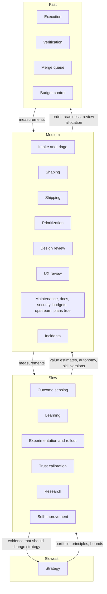
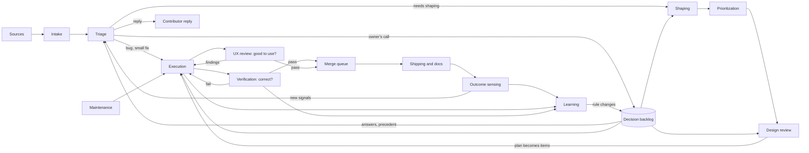

# 2. The system as loops

[Back to the index](../0001-human-in-the-lead.md)

The system is a set of loops. Each loop is a **queue** of work waiting for a stage, a **WIP limit** on how much the stage holds at once, **sensors** that measure it, a **controller** that acts on the measurements, and **escalation rules** that say when the owner (or an area owner) is involved. The main flow is 2.1–2.8; the loops beside it are 2.9–2.20.

## Loops nested by speed

The loops run at different speeds, and **slower loops set the setpoints for faster ones**. Strategy sets the portfolio balance that prioritization holds; trust calibration sets which questions the fast loops may settle alone; the budget controller works inside quotas the owner set. A fast loop never changes a slow loop's setpoint; it reports to it.

| Speed | Loops | Sets setpoints for | Stability rules |
|---|---|---|---|
| **Fast** (per dispatch, per merge) | Execution (2.5), verification (2.6), the merge queue ([part 14](14-integration.md)), budget control ([part 12](12-reporting-and-limits.md#125-quotas-and-budgets)) | Nothing; they act inside their setpoints | Controller moves inside owner-set bounds; minimum samples per move; one setting at a time |
| **Medium** (per batch, per release) | Intake and triage (2.1–2.2), shaping (2.3), design review (2.11), UX review ([part 7](07-ux.md)), prioritization (2.4), shipping and incidents (2.7), maintenance (2.9), docs (2.12), keeping plans true (2.18), security (2.16), non-functional budgets (2.17), upstream (2.20) | Fast loops: the ready queue's order, which items are ready, review allocation | As above, plus larger minimum samples and hysteresis bands |
| **Slow** (across releases) | Outcome sensing (2.10), experimentation and rollout (2.19), learning (2.8), trust calibration (2.15), research (in shaping, 2.3), self-improvement ([part 18](18-self-improvement.md)) | Medium loops: value estimates, autonomy levels, skill and policy versions | Changes only as experiments with a verdict; heavy damping; **every change is an owner decision** |
| **Slowest** (on evidence, not on the calendar) | Strategy (2.14) | Everything: north star, principles, non-goals, portfolio balance, the owner's bounds | Owner only |

The rules are strictest on the slow loops because their mistakes last longest: a wrong concurrency setting costs one batch, a wrong autonomy grant costs many decisions, and a wrong strategy costs the whole portfolio.

**Loops run on evidence, not on the calendar.** Agents keep no office hours, so nothing recurs because a day or a week has passed. What matters is how much has changed and whether the owner is there. The chief of staff looks and reports on events first (HITLD-536): a pull request's checks finish, an executor goes quiet, a decision is waiting, the pace line is crossed, a usage reading goes stale. A slow timer of every few hours only catches a lost event, and a digest is sent when something needs the owner, not on the clock. A report or digest is due when enough merges, decisions or value have accumulated, when the owner writes, or when the machine is idle; a ceiling only limits how long the owner may hear nothing. A calibration review is due when enough new outcomes have arrived. The count thresholds (`digests.every_merges`, `reports.every_merges` and the like) stay as triggers: a count of what has changed is evidence, not the clock, so it fits events first (HITLD-536). Baselines and offline evals run when the integration branch has moved and the machine is idle. `hitld cadence due` works this out from the ledger and the machine's state, and the chief of staff runs what it lists ([13.3](13-operations.md#133-the-scheduler-later-milestone)).

### The main flow

## Common rules

These apply to every loop.

- **Every queue is visible.** Each queue is a query over the tracker or the ledger, so its stock (how many items wait) and its flows (arrivals and departures per period) are always computable. No work waits in an agent's context or in chat.
- **WIP limits are settings.** Each limit is a key in `policy.json` with owner-set bounds. Controllers may move it inside the bounds ([part 11](11-metrics-and-control.md)).
- **Leading indicators drive control.** Delays between an action and its effect cause oscillation (a standard result in control theory and system dynamics; Sterman, *Business Dynamics*, covers it for delayed feedback loops). So each controller acts on the earliest signal available: queue growth rather than lead time, the first failed check rather than the escaped defect.
- **Little's Law sizes the queues.** For a stable queue, average WIP = throughput × average time in the stage. A WIP limit therefore caps time in the stage for a given throughput; when a stage's queue grows while its throughput holds, it is the constraint.
- **The constraint gets protected.** Following the theory of constraints, the system identifies the current constraint (usually the owner's attention or the merge queue), keeps it busy with the right work, keeps it from waiting on anything else, and subordinates the other stages to its pace. Feeding a stage faster than the constraint can drain it only grows a queue.
- **Escalation means "this call is someone else's by the decision rights"**, never "this is hard". Hard but in-rights work goes up the model-and-effort cascade ([5.1](05-execution.md#51-execution-profiles)), not to the owner. The full rules are in [part 4](04-decision-rights.md).

---

## 2.1 Intake

**Purpose.** Turn anything that arrives, from any source, into a **signal** with provenance. Intake does not judge; it records.

| | |
|---|---|
| **Inputs** | Intake source adapters ([part 3](03-data-model.md)): issue trackers, PR comments, email, chat, the owner's notes through Remote Control, failing tests and CI, research findings, crash reports, the learning loop's own findings. |
| **Queue** | Raw signals not yet normalized. |
| **WIP limit** | Batch size per intake pass (`intake.batch_max`). Intake is cheap; the limit exists so one burst (a spam wave, a CI outage producing hundreds of failures) cannot flood triage. |
| **Sensors** | Arrivals per source per period; normalization failures; duplicates per source; share of signals rejected as spam or abuse. |
| **Controller** | Rate shaping per source: when a source's arrivals exceed `intake.burst_threshold`, its new signals are collapsed into one burst signal ("CI produced 312 failures in run X") for triage to handle as one. |
| **Escalation** | None by default. A source that starts producing unparseable or hostile content raises a security signal ([part 10](10-security.md)). |

**Normalization.** Each raw item becomes a signal: source, external reference, author (mapped to a contributor record when known), received time, raw body, a short normalized summary, a guessed kind, and a classification. The raw body is **untrusted data**: it is stored as data, quoted, never executed and never treated as instructions ([part 10](10-security.md)). The agent that normalizes it runs quarantined: it has no write access beyond the signal record and no network.

## 2.2 Triage

**Purpose.** Decide what each signal is and where it goes, without the owner unless the call is theirs.

| | |
|---|---|
| **Queue** | Signals in state `new`. |
| **WIP limit** | `triage.wip` signals per triage pass. Triage runs as a background agent per batch, its model and effort from the cascade ([5.1](05-execution.md#51-execution-profiles)). |
| **Sensors** | Queue stock; time from arrival to triage; routing accuracy (share of routes later changed by a human or a downstream agent); duplicate-detection precision and recall (from later merges of duplicates the triager missed, and from wrongly merged signals reopened). |
| **Controller** | Batch size follows queue stock within bounds. Routing confidence below `triage.confidence_floor` sends a signal to a triager one rung higher in the cascade rather than to the owner. |
| **Escalation** | To the owner only when the signal itself carries an owner's call: a security report, a request touching a public commitment, a relationship matter (a partner, a complaint, a code-of-conduct report), or a question addressed to the owner personally. Everything else is routed by rule or precedent. |

**Steps.**

1. **Deduplicate.** Match against open signals and items by normalized summary and, for bugs, by stack trace, error text, and component. A duplicate links to the existing signal and adds its evidence (more reports raise reach).
2. **Classify.** Kind (bug, feature, idea, question, incident, research finding, test failure), area (from [part 9](09-contributors.md)'s area map), severity (for bugs and incidents), reach (how many users or contributors are affected, from duplicate count and source), and classification level.
3. **Reproduce bugs into failing tests.** For a bug with enough information, a **reproducer** agent writes a failing test that captures it. A reproduced bug is worth more than an unreproduced one: it has an executable acceptance criterion ([part 6](06-verification.md)). If it cannot reproduce, it drafts a request for the missing information. The reproducer must read the reporter's steps and error text, which are untrusted, and must write and run code, so it is confined accordingly: it works in a sandboxed scratch worktree with no network, no secrets and no private data, may write only under the test directories, cannot commit to any branch the merge queue takes, and its output (a test file and a verdict) is checked by script before an item uses it ([part 10](10-security.md#102-least-privilege-per-role)). It holds untrusted input and the ability to run code, but no private data and no outbound channel, so a successful injection has nothing to steal and nowhere to send it.
4. **Route** to exactly one of:
   - **auto-fix**: a reproduced bug becomes a `planned` work item and goes straight to the ready queue, but only when a confirmed precedent allows auto-fix for its area, blast radius and the reporter's trust level ([part 9](09-contributors.md#92-trust-levels)). Until the owner confirms such a precedent, a reproduced bug becomes a `proposed` item with its failing test attached, and committing it to `planned` needs a person to commit it, in the main session (an area owner may do so later, once signed answers exist; HITLD-36). Reproduced bugs from unknown (T0) reporters always wait for a person, even when a precedent allows auto-fix for known reporters;
   - **backlog**: a `proposed` item, or a signal attached to a project being shaped, for shaping;
   - **owner**: a decision item, under the rules above;
   - **contributor reply**: a drafted answer to a question, a request for information, a thank-you, or a polite decline that cites a non-goal ([part 9](09-contributors.md));
   - **closed, no action**: spam, abuse, or out of scope by an existing precedent, with the reason recorded.

**Strategy as input.** Triage reads the owner's strategy page (north star, principles, non-goals; [part 8](08-knowledge-base.md)). A signal that falls under a non-goal is routed to a reply that says so, citing the non-goal, not to the owner.

## 2.3 Shaping

**Purpose.** Turn clusters of signals into **projects** that are ready to bet on. A project being shaped is a `proposed` project: a problem statement, evidence, options, value, confidence, and an appetite. This adapts Shape Up's shaping. Shape Up's appetite is the time a team is willing to spend; in this design **appetite** is how big the work is estimated to be, in tokens, from its item estimates, and what the owner allows a commitment to spend is its **budget** (HITLD-577).

| | |
|---|---|
| **Queue** | Proposed projects nobody has shaped yet (a cluster of signals exists), ordered by the cluster's reach and the cost of delay of its strongest signal. |
| **WIP limit** | `shaping.wip` projects in shaping at once. Shaping is design-heavy work ([5.1](05-execution.md#51-execution-profiles)), and it spends the owner's attention at the end (the bet), so the limit is low. |
| **Sensors** | Shaped projects waiting for a bet (if this grows, shaping is outrunning the owner); share of shaped projects the owner drops (shaping quality); appetite overrun rate on bets that ship. |
| **Controller** | When projects waiting for a bet exceed `shaping.awaiting_bet_max`, shaping pauses and its capacity goes to execution. When the owner's rejection rate rises, shaping requires more evidence before presenting (for example, desk research or a spike). |
| **Escalation** | The bet is always the owner's (or the area owner's) call: it commits the project. Shaping escalates early, as a decision, when it finds conflicting evidence or when every option crosses a public commitment. |

**A project being shaped has** ([part 3](03-data-model.md#project) has the fields):

- **Problem:** in the user's terms, citing the signals.
- **Evidence:** signals, reproductions, measurements (runs and studies from the project's benchmark tool), desk research.
- **Options:** two or three ways to address it, each with what it trades off. "Do nothing" is always an option, with its cost of delay.
- **Value:** a positive number in the project's value units, with a **confidence** (a probability that the value materializes if built). The pair is what prioritization uses. The unit is the project's own and it is the same for a project and for a milestone's contributions, so a value divided by tokens is a ratio. 1, 2, 3, 5, 8 and 13 are quick choices for the person entering a value, not the only values.
- **Cost of delay profile:** standard (value lost at a steady rate), urgent (high rate now), fixed-date (value falls to near zero after an external date), or intangible (low rate now, rising later, as with technical debt).
- **Appetite:** how big the work is estimated to be, in tokens, from its item estimates (HITLD-577, HITLD-412). The project holds it, and each milestone holds its share. What a commitment may spend is set by its budget, not by the appetite ([4.6](04-decision-rights.md#46-autonomy-changes-with-the-record)).
- **Milestones:** the outcome cut into thin, checkable future states for users, each with its "done when", its constraints and its share of the project's appetite ([part 3](03-data-model.md#milestones-and-releases)). `hitld work check` verifies that the shares fit. Their outcomes are what would show, after shipping, that the problem is solved; outcome sensing checks them ([2.10](#210-outcome-sensing)).
- **Out of scope and risks:** what is explicitly out, and the known holes the work could fall into.

**The bet.** The owner's bet is the answer to the project's decision, a decision item the project names in `decision`. The answer moves the project from `proposed` to `planned`, and who made the bet is read from that answer, never stored. A project the owner rejects is `dropped`, with the reason. A judgment on a project raises it in the shaping queue; it never makes the bet ([part 3](03-data-model.md#judgment)).

**Research.** When a project being shaped needs market or user understanding, a researcher agent does desk research and records sources with dates read. When real people must be asked, the system writes the owner a **research brief**: the hypotheses, who to ask, the questions, and for each hypothesis, what answer would change the plan. Research outputs are `confidential` by default ([part 10](10-security.md)).

**Spikes and speculative execution.** When confidence is low and a cheap build would raise it, shaping may dispatch a throwaway spike within a small slice of the appetite. When the cost of delay is high and two approaches are both plausible, shaping may recommend building both in parallel and choosing by evidence ([part 5](05-execution.md)).

## 2.4 Prioritization

**Purpose.** Order the work so the objective ([part 1](../0001-human-in-the-lead.md#13-the-objective)) rises fastest.

| | |
|---|---|
| **Queue** | Planned projects not yet cut into milestones and items; `planned` milestones with unmet clauses; and `planned` items not yet ready or not yet dispatched. |
| **WIP limit** | Active projects at once (`prioritization.active_projects_max`), and, once milestones are built, active milestones per project (`prioritization.active_milestones_max`). Many half-done projects deliver nothing; few finished ones deliver value. |
| **Sensors** | Cost of delay accumulating in the queue (sum over waiting items of their cost-of-delay rate); each active milestone's error (its unmet clauses) and critical-path progress; appetite spent against scope per milestone; portfolio mix (share of tokens per category against the owner's target shares). |
| **Controller** | Ordering by the rule below, recomputed on every change to the queue. Portfolio drift beyond `prioritization.portfolio_tolerance` reorders within ties to pull the mix back. When a milestone's spend runs ahead of its appetite, the orchestrator cuts its lowest-value contributions. |
| **Escalation** | Reprioritization of a bet across categories, any change that delays a fixed-date item or milestone past its date, and any change to a milestone's outcome, clauses, constraints or appetite are the owner's call. Ordering within a project, and adding or cutting contributions within a milestone's appetite, are the orchestrator's. |

**The ordering rule.** Weighted shortest job first (WSJF, after Reinertsen's work on cost of delay): **cost of delay divided by size**, where size is the token estimate. For dependent items, the critical path dominates: an item that unblocks others carries the cost of delay of everything behind it. Adjustments:

- **Milestones** (planned, [part 3](03-data-model.md#milestones-and-releases)). A milestone's constraint carries the milestone's whole cost of delay, because without it no clause comes true. A contribution carries its own value × confidence (value in the project's value units, the same as a project's), and enters the queue only while it is inside the milestone's scope (the contributions kept in scope by value per token; how scope relates to a budget is not decided, see [part 3](03-data-model.md#milestones-and-releases)). There are no priority labels: what must happen is a constraint, everything else is scored.

- **Value of information.** A study or spike whose verdict would change which option is chosen carries the expected value of that change. This lets cheap experiments jump ahead of expensive builds when the choice is uncertain.
- **Owner judgment as a prior.** A signal or a project being shaped that carries an owner judgment ([part 3](03-data-model.md#judgment)) has its value and confidence raised by the judgment's weight. This raises it into shaping; it never settles the bet. When shaping, research or a study revises the estimate, the project records why. When evidence **contradicts** a judgment, the system neither overrides it quietly nor defers to it quietly: it puts the conflict to the owner as a decision, with the evidence and a recommendation, and the answer becomes precedent.
- **Portfolio balance.** The owner sets target shares per category in `policy.json`. The rule does not override cost of delay; it breaks ties and corrects drift within tolerance.

The owner can always reorder directly, in the main session. A direct reorder is recorded with its reason as a decision, so the system can learn whether its weights are off.

## 2.5 Execution

**Purpose.** Turn ready items into verified commits, as many in parallel as the constraints allow. Detail in [part 5](05-execution.md).

| | |
|---|---|
| **Queue** | Ready items: state `planned`, every `needs` entry `done`, no open blocking decision. |
| **WIP limit** | Executors in flight, as many as measured resources, the pace controller, merge risk and the owner's awaiting-merge queue allow, under the hard ceiling `execution.max_executors` (HITLD-534); plus one per serial resource (GPU, merge queue). |
| **Sensors** | Slot utilization; first-pass yield per execution profile and item type; tokens per dispatch against estimate; merge conflicts; serial-resource waits; questions raised; the orchestrator's own context use. |
| **Controller** | Concurrency by additive increase and multiplicative decrease against the pace line ([12.5](12-reporting-and-limits.md#pace)); the cascade's starting rung by first-pass yield; each commitment's budget ([part 11](11-metrics-and-control.md)). |
| **Escalation** | Executors make cheap-to-undo calls and log them. Calls that are not theirs become decision items; work continues elsewhere. The question protocol is in [part 5](05-execution.md). |

## 2.6 Verification

**Purpose.** Establish that a change does what its item says and breaks nothing, with evidence that does not depend on the author. Detail in [part 6](06-verification.md).

| | |
|---|---|
| **Queue** | Executor reports waiting for verification (independent tests, adversarial pass, review where allocated), then branches waiting for the merge queue. |
| **WIP limit** | Verification agents in flight (`verification.wip`); merge batch size (`merge.batch_max`). In `merge.mode: owner` the owner names each merge, so batch-size control does not apply. |
| **Sensors** | First-pass yield; defects found per verification kind and per token spent; mutation score on changed code; flake rate ([14.7](14-integration.md#147-flaky-tests)); escaped defects (found after merge) per area. |
| **Controller** | Review and adversarial allocation by defect yield per area and execution profile; merge batch size by recent batch failure rate (smaller batches when failures rise, so bisection is cheaper). |
| **Escalation** | A human reads code only on the triggers in [part 6](06-verification.md). A verification disagreement (tests pass but an adversary or reviewer reports a credible break that the author disputes) goes to the area owner. |

## 2.7 Shipping

**Purpose.** Turn merged work into releases people can use: versions, changelogs, deprecations, documentation.

| | |
|---|---|
| **Queue** | Merged items not yet in a release. |
| **WIP limit** | One release in preparation at a time. There is no release train by default. |
| **Sensors** | Merged-but-unreleased stock and its accumulated cost of delay; delay from merge to release; release failure rate (releases needing a hotfix or rollback); docs coverage of changed public surface; the interface delta since the last release. |
| **Controller** | `main` is always green, so a release can be cut at any merge. Propose a release when the unreleased stock's cost of delay exceeds the cost of a release (`shipping.release_threshold`), when the check of a milestone a release item needs passes, or before a fixed-date deadline. |
| **Escalation** | Version bumps that break compatibility, deprecations, and anything that changes licensing are public commitments: owner's call. A routine patch release may follow a precedent the owner confirmed, because a patch never changes the interface. Minor and major releases are always the owner's call. |

**What ships with each item.** An item that changes public surface carries, as part of its "done when": a changelog line (with credit, [part 9](09-contributors.md)), documentation changes, and for removals, a deprecation note with the version it will be removed in. The release notes are generated from the merged item files, so shipping is assembly, not writing.

**Releases as records** ([part 3](03-data-model.md#release)). `hitld release propose` reads the interface delta since the last tag (schemas, CLI and MCP JSON, the executor contract, the report shape, trailers), proposes the bump from that delta alone, drafts the notes from the items' changelog lines, and lists gaps: public-surface changes without a changelog line, and milestones a release item needs whose check has not passed. Internal change never raises the bump. The owner makes each minor and major release, and a patch may follow a confirmed precedent; `hitld release make` writes the release record and the tag, and every released item gains `released_in`. Releasing often keeps the outer loop through users short: outcome sensing ([2.10](#210-outcome-sensing)) counts its checks in releases, so a slow release cadence slows learning.

**Emergent escalations** (HITLD-441, HITLD-544 to HITLD-546). A problem found while work is going that blocks, distorts or endangers the rest of it is dealt with before planned work:

- **Rules detect; the chief of staff declares the rest** (HITLD-545). A closed list of mechanical conditions the system detects raises an escalation automatically. The first entries come from incidents: every start blocked by one bad record, a dispatch holding a slot with no live session, a finished but unmerged item offered again, and a status that contradicts its own conclusion. For anything else the chief of staff declares an escalation, with a reason from the same list. The owner is told and can demote it.
- **First in the queue, with a reserved slot.** The planner puts escalations first and keeps one slot reserved for them, even when the pace line says slow. The quota reserve still holds: an escalation never spends it, and when only critical-path work may start, an escalation counts as critical path ([12.5](12-reporting-and-limits.md#control)). An item the owner holds stays held, even when an escalation would otherwise pick it up.
- **Its fix may start without a new yes, within a cap** (HITLD-546). The fix for a declared escalation may start at once in the reserved slot, within a small budget per escalation. Anything over that budget, any one-way-door change, or anything on a never-unlock kind still waits for the owner's yes. The owner is told when it starts. Escalation fixes are their own kind in the trust engine ([2.15](#215-trust-calibration)), so their standing grows or shrinks on evidence.

The size of the per-escalation budget and of the reserved slot are not decided (HITLD-441). *Decided, not built (HITLD-556).*

**Incidents** are a fast lane through intake, triage, execution and shipping:

- **Severity** is set at triage: sev-1 (users broken now, or a security exposure), sev-2 (degraded, workaround exists), sev-3 (minor).
- A sev-1 bypasses quiet hours and every queue: it pages the owner at once (this is the algedonic channel in [part 19](19-viable-system-model.md)). **Rollback first**, fix second.
- The fix runs in its own session ([5.1](05-execution.md#51-execution-profiles)), verified with the same rigor, shipped as a hotfix. The built sizing moves an item up one tier for blast radius. *Not decided:* how blast radius enters an execution profile; HITLD-581 is silent on it (tracked in HITLD-561).
- Every sev-1 and sev-2 gets a **blameless review**. Its output is not a document to file; it is one or more **rule changes** (to a skill, a policy setting, an invariant, a test), each proposed to the owner as a decision.

## 2.8 Learning

**Purpose.** Change the system itself so the next piece of work goes better. This is double-loop learning: not only "fix this defect" (single loop) but "change the rule that let it through" (double loop).

| | |
|---|---|
| **Queue** | Learning candidates: escaped defects, retried and reverted dispatches, owner overrules of precedent, recurring questions, knowledge-base misses reported by executors, controller oscillations, incident reviews. |
| **WIP limit** | One rule change in experiment at a time per controlled setting, and `learning.experiments_max` overall ([part 11](11-metrics-and-control.md)). |
| **Sensors** | All of [part 11](11-metrics-and-control.md)'s metrics, plus the ledger. |
| **Controller** | Retrospectives are triggered by friction signals, a second sighting of the same friction or a rate above its limit, with a slow safety-net timer (HITLD-594; the signals are built, as `friction` events in the ledger, [18.4](18-self-improvement.md#implicit-friction-signals) (HITLD-595); the controller, HITLD-596, is not). A retro proposes changes. Changes inside policy bounds that a controller owns are applied by the controller. Anything else (a new rule, a skill change, a bound change) becomes an experiment with a hypothesis and a verdict, must pass the eval suite ([part 17](17-evals.md)), and adopting it is the owner's decision. |
| **Escalation** | Every rule change is the owner's decision ([part 4](04-decision-rights.md)). |

**Retro output shape.** A short list of proposals, each: the observation (with ledger and metric citations), the hypothesis ("if we change X, metric Y improves without metric Z, its Goodhart pair, getting worse"), the change, how it will be tested (replay or live, [part 11](11-metrics-and-control.md)), and the minimum sample before a verdict.

---

## 2.9 Maintenance

**Purpose.** Keep the project healthy continuously, rather than in occasional cleanups: dependency and toolchain upgrades, security advisories, the technical-debt register, and deprecation of internal APIs.

| | |
|---|---|
| **Inputs** | Dependency update feeds (Dependabot or Renovate pull requests, or `hitld` reading the lockfile against the registry); security advisories in machine-readable form (OSV, the GitHub Advisory Database); the **technical-debt register** (debt items any executor or reviewer may file, each with its cost: what it slows down and by how much evidence); internal APIs marked deprecated |
| **Queue** | Maintenance items, ordered by cost of delay like any other work: a security advisory affecting a reachable code path is urgent; a minor version bump is standard; debt is intangible (low now, rising later) |
| **WIP limit** | A **capacity share** set by the portfolio balance (`prioritization.portfolio` category `maintenance`); prioritization keeps maintenance at that share within tolerance, so it never starves and never crowds out delivery |
| **Sensors** | Dependency age (versions behind, per dependency); open advisories by severity and age; debt register size and the cost cited for it; uses of deprecated internal APIs remaining |
| **Controller** | When open advisories above `maintenance.advisory_severity` exist, they take precedence over the share until cleared. Otherwise the share holds |
| **Escalation** | A new dependency, a major-version upgrade, or a toolchain change is the owner's (security and blast radius, [part 4](04-decision-rights.md#42-when-the-owner-is-involved)). Patch and minor upgrades that pass verification follow precedent. A vulnerability report about the project itself is always the owner's |

Upgrades are items with "done when" = the full suite passes on the new version and no API the project uses was removed. Internal deprecations get a removal milestone, and the stale-item sweep ([part 13](13-operations.md#133-the-scheduler-later-milestone)) reports remaining uses.

## 2.10 Outcome sensing

**Purpose.** Close the loop on the objective ([part 1](../0001-human-in-the-lead.md#13-the-objective)): after shipping, find out whether the work achieved the outcome it was shaped for. Without this the system measures output and calls it outcome.

| | |
|---|---|
| **Inputs** | Per shipped project, its milestones' outcomes and the problem it was shaped for (what would show that the problem is solved), plus: adoption and downstream usage where observable (package downloads, dependents, API calls in public code, feature use where the product reports it with consent); issues filed against the feature; support questions; benchmark trends for performance work; contributor and user feedback |
| **Queue** | Shipped projects whose **outcome check** is due (`outcome.check_after`, counted in releases or in observations, not in time) |
| **WIP limit** | Outcome checks in progress (`outcome.wip`) |
| **Sensors** | Realized value against the value estimated at shaping, per project and per category; time from ship to observed outcome |
| **Controller** | Calibration: shaping's value and confidence estimates are compared with realized outcomes, and their bias and spread are fed back to shaping and prioritization |
| **Escalation** | An outcome clearly missed (the problem persists) creates a signal for triage. A pattern of missed outcomes in a category is a retro input and may be a strategy question for the owner |

Each project's **outcome check** records: the measures, what was observed, a verdict (solved, partly, not solved, not observable), and the evidence. Its form is a study ([part 3](03-data-model.md#study-run-verdict)). Usage evidence feeds UX ([part 7](07-ux.md#77-after-shipping-and-learning)) too. Any telemetry follows the project's consent and privacy rules; the system adds none of its own to the product.

## 2.11 Design review

**Purpose.** Between shaping and items, a stage where a plan is written, the owner reviews it through questions, and only then does it become items. This is where design-heavy work gets the owner's judgment once, cheaply, instead of in pieces during execution.

| | |
|---|---|
| **Queue** | Planned projects that need a design (any with design-heavy work, a public surface, or a new pattern) |
| **WIP limit** | Designs awaiting the owner's review (`design.awaiting_review_max`) |
| **Sensors** | Review turnaround; questions per design; designs reopened during execution (a design that missed something) |
| **Controller** | When designs reopen often in an area, the design template for that area gains required sections |
| **Escalation** | The review itself is the owner's (or the area owner's) by definition |

**Steps.**

1. An agent in its own session writes the plan from a template (`templates/design.md`): intent, constraints, approaches considered with trade-offs, the chosen approach, risks, the milestones and items it will become with their "done when".
2. The agent extracts the **judgment calls** and asks them as decision questions, each with a recommendation ([part 4](04-decision-rights.md#the-decision-question)), batched into one review.
3. The owner answers; answers are recorded on the design and become precedent where they generalize.
4. **The gate:** a design becomes items only when every judgment call is answered. The orchestrator then creates the items, pointing their plan sections at the design.

This design document is itself an example of the stage.

## 2.12 Documentation keeps up with the code

User docs, API reference, examples and project handbooks are updated **as part of finishing the work**, not afterwards:

- The docs gate is a policy setting (`docs.gate`, design only so far; a project can turn it off). With it on, an item that changes behavior users see carries documentation changes in its "done when", checked in the merge queue: a public symbol without reference docs, an example that no longer runs, or a changed flag missing from the user guide fails the check.
- **Docs are part of done** (HITLD-579). An item is not done until the docs and design parts it affects are updated, in the same pull request, so the docs stay true to what was built and decided. *Decided, not built (HITLD-580):* the proposed build adds the line to every item's "done when", a check by command that maps changed paths to the design parts they affect and fails a change that touches an affected area without touching its docs unless a `Docs:` trailer says why, and a rule that a change whose docs check is red is not eligible to merge without asking; the path-to-part table and the trailer form are still to be shaped.
- **Examples run.** With the docs gate on, code examples in docs are executed as tests, so they cannot rot silently.
- **Freshness** works as for the knowledge base ([part 8](08-knowledge-base.md#85-the-kb-tool)): each page records `checked` and `checked_at` and its `sources`; `hitld kb stale` covers docs too, and the curator's loop refreshes the most-read stale pages.
- API reference is generated from the code where the language supports it; prose around it is maintained like any page.

## 2.13 UX design and review

A loop beside verification whose evidence is "good to use", not "correct", including developer experience for libraries. Specified in [part 7](07-ux.md).

## 2.14 Strategy

**Purpose.** The slowest loop: revisit the north star, principles, non-goals and portfolio balance when evidence says they may be wrong.

| | |
|---|---|
| **Triggers** | Evidence, not the calendar: outcome sensing showing a category repeatedly missing its outcomes; research findings or a research brief's answers that contradict an assumption in the strategy; a shift in the environment the project depends on (a platform change, a competitor's move, a new constraint); precedents that keep overruling a principle; a portfolio share persistently unmet |
| **Queue** | Strategy questions, each with the evidence that raised it |
| **WIP limit** | One strategy review at a time |
| **Sensors** | Realized outcomes per category against weights; how often non-goals are cited in declines; principle-related overrules |
| **Controller** | None automatic. An agent prepares a **strategy review**: the evidence, what it suggests changing, the options, a recommendation, and what each option would change downstream (portfolio shares, bounds, which projects would rise or fall) |
| **Escalation** | Always the owner |

**Outputs are setpoints**: the strategy page ([part 8](08-knowledge-base.md#83-structure)), the portfolio weights and target shares that prioritization holds, the bounds the controllers move within, and the non-goals triage cites. A strategy change is recorded as a decision, and precedents that cite changed text are flagged for review ([part 4](04-decision-rights.md#keeping-precedent-healthy)).

## 2.15 Trust calibration

**Purpose.** Match the system's autonomy to its record, kind of decision by kind of decision, so the owner's attention cost falls as trust is earned, and rises again where it is lost. Trust rests on risk and outcomes, never on a count of how often the owner said yes (HITLD-473). **Its data collection is in "One signal end to end"** ([part 21](21-scope.md)), so the record exists from day one.

### The trust engine

One trust engine serves every process that acts without asking (HITLD-525). *Decided, not built:* the engine is built with merging and commitment together (HITLD-528; HITLD-552 to HITLD-555), in release stage rc.5 (HITLD-551, milestone HITLD-566). Until then trust is recorded as described under "What the built record measures" below, and only the owner's standing delegations act without asking.

- **Supervision modes, not a ladder** (HITLD-527). A kind of decision runs under a **supervision mode**, such as ask first, tell then proceed, proceed and report, an independent check, or two people. Each process registers its modes, which mode is tighter than which (a partial order, so two modes can be incomparable) and the unlock steps it allows. "Most restrictive wins" and "a classifier can only tighten" need only that order. A ladder is the special case where the modes form a chain. Limits such as a budget cap stay in a kind's definition, not in the mode.
- **Processes register; the engine owns the rest** (HITLD-525). Each process registers its kinds of decision, its evidence signals and its verifiability rule, and asks the engine whether it may proceed. The engine owns the unlock bar, the re-lock on a miss, the trust record and the owner's unlock proposals. A new process is a registration, not a new system.
- **Shared evidence, plus each process's own** (HITLD-548). The engine owns the signals every process has: the owner's report that a decision was wrong, a re-opened or reverted outcome, and aging without objection. Each process registers its own on top: a failing check on main for merging, a budget overrun for commitment, a missed escalation for escalation fixes. The owner's report is always a miss, in any kind.
- **The unlock bar and the re-lock.** A kind is proposed for unlocking only when its evidence meets the bar, and what a miss does depends on the kind. A merging kind re-locks at once and its evidence starts again from zero (HITLD-479); a commitment kind drops one mode (HITLD-506); any other process registers its own rule with the engine (HITLD-525). Moving a kind up again is a new proposal to the owner. Merging's bar is 15 merges that have each aged 7 days with no evidence against them, from at least 8 distinct items; the numbers are fixed settings in policy that only the owner changes, and the measuring of HITLD-408 may propose a change from evidence (HITLD-478, HITLD-479, HITLD-521).
- **The record is derived** (HITLD-529). A kind's mode is the latest signed unlock decision for it, minus any re-lock event after it; its evidence (aged merges, reverts, budget outcomes) is computed from ledger events and tracker records on demand. There is no separate counter to drift or to edit, and a lost record is rebuilt.
- **Per project** (HITLD-526). Trust is earned and recorded in each project's own record. In another project the system may propose the same unlock, citing the first project's evidence, and the owner decides.
- **One Trust view, and proposals as decisions** (HITLD-547). One view lists every kind with its current mode, the evidence behind it and how near it is to its unlock bar ([12.1.3](12-reporting-and-limits.md#1213-the-dashboard-page)). An unlock proposal arrives as a normal decision in the owner's queue, showing the evidence and a sample (HITLD-519). Nothing unlocks until the owner answers.
- **Initial grants** (HITLD-576). The owner's standing delegations of today, tracker-only merges and reversible tracker edits, become kinds already unlocked by a decision the owner signs, dated when it is recorded and citing the standing rule, with the same evidence and re-lock as any kind.

**What registers.** Merging without asking ([14.2](14-integration.md#142-the-queue)); committing to work against a budget, and choosing the next goal ([4.6](04-decision-rights.md#46-autonomy-changes-with-the-record)); escalation fixes ([2.4](#24-prioritization)); and tracker edits by the chief of staff and the curator (the initial grants above). Which process registers next, to test the shape (releases, for example), is decided when the engine is built (HITLD-507).

**Not trust inputs.** The owner's answer speed is not read as inattention, and small-sample thresholds do not decide when a pattern counts (HITLD-535): `trust.rubber_stamp_seconds`, `precedent.review_min_applications` and `review.first_after_outcomes` stop being inputs to any trust or review decision (built in HITLD-557, not yet). A measure of how well the owner's reviews keep up, if wanted, is a metric (HITLD-408), not a rule. A preference about how the owner likes to work never widens what the system may do alone ([4.6](04-decision-rights.md#46-autonomy-changes-with-the-record)).

### What the built record measures

The built trust record (`core/lib/rights/trust.mjs`) records; it decides nothing. It measures, per area and per kind of decision:

| Measure | Definition | Collected from the start by |
|---|---|---|
| **Overturn rate** | Share of the system's decisions (logged calls, triage routes, precedent applications, controller moves) that the owner later reversed | Reversals recorded as ledger events against the decision they reverse |
| **Escalation worth** | Of the questions sent to the owner, the share the owner rated worth asking | A one-tap rating offered with each answer ("worth asking? yes / no"), optional and never required |
| **Precedent-match accuracy** | Of precedent applications, the share not overruled; of questions sent to the owner despite a candidate precedent, the share the owner answered as the precedent would have | Precedent application and overrule events |
| **Input calibration** | How well owner judgments on signals and projects being shaped predicted outcomes (below) | Judgment records and outcome checks |

**Proposals, never self-grants.** *Superseded by the trust engine above (HITLD-525).* The engine owns unlock proposals, per kind of decision and per project, on evidence and not by area (HITLD-473, HITLD-526). The per-area measures in the table can stay as metrics (HITLD-408) or be registered as a process's evidence signals (HITLD-548, HITLD-535). What follows is the earlier per-area design, which describes the built behavior until the engine is built (HITLD-552). When a record supports it, the loop proposes a change of autonomy to the owner as a decision:

- **more autonomy** where the system has been reliably right: a class of question becomes a logged call, a precedent's scope widens, auto-fix opens for an area, a review rate falls;
- **less autonomy** where it was corrected: a class of logged call becomes a question again, a precedent narrows, review rises.

The system never grants itself autonomy; every change is the owner's decision, recorded with the evidence, and appears in the audit trail ([part 3](03-data-model.md#audit-record)). When the owner approves a change of autonomy for a class of question, the eval suite's labels for that class change with it, so escalation precision and recall keep measuring against the rules in force ([part 17](17-evals.md#174-metrics)).

**Calibrating inputs, not grading people.** The same method weighs inputs. Judgments ([part 3](03-data-model.md#judgment)) are compared with outcomes per area, and each person's weight tunes itself from the record; the owner's gut checks start high. A weight is an estimate, not a setting, so it is the one slow-loop value that changes without an owner decision: it shrinks toward the default, moves only as far as its evidence supports, and two fixed rules bound it ([part 23](23-people-in-the-lead.md#233-calibration-as-a-prior)). This adjusts how much an input counts in prioritization; it does not score the person who gave it.

**The calibration review is due on evidence.** Each person's review ([23.4](23-people-in-the-lead.md#234-feedback-to-the-person-the-calibration-review)) is due after `review.every_outcomes` new outcomes of their calls. As built, a person who has had none is due after `review.first_after_outcomes`; that threshold is dropped (HITLD-535), and what makes a first review due instead is not decided (the threshold's removal is HITLD-535, built in HITLD-557; no item names a replacement). No calendar date makes it due.

## 2.16 Security

**Purpose.** Keep security a continuous loop, not a one-time design ([part 10](10-security.md) sets the boundaries; this loop tests and maintains them).

| | |
|---|---|
| **Inputs** | Threat models from design review; findings from security testing; advisories from maintenance; private vulnerability reports; red-team results against the agents |
| **Queue** | Security items, ordered by severity and exposure |
| **WIP limit** | Security items ahead of other work up to `security.share_max`, after which they share capacity by cost of delay |
| **Sensors** | Open findings by severity and age; time from private report to fix and disclosure; red-team pass rate |
| **Escalation** | Every vulnerability report and every disclosure is the owner's; so is any change to a trust boundary |

**Parts of the loop:**

- **Threat modeling at design review** ([2.11](#211-design-review)): every design with a new trust boundary, input path or privilege lists its threats (STRIDE as a checklist) and the mitigations, which become items and tests.
- **Security testing**: static analysis and dependency audits as declared merge checks, diff-aware against a baseline, each new finding with a recorded triage verdict ([10.5](10-security.md#105-security-in-done-when)); fuzzing for parsers and loaders ([part 6](06-verification.md#63-test-kinds-and-the-adversarial-loop)); findings become items with severity.
- **Private vulnerability intake**: a separate intake source for vulnerability reports (GitHub private vulnerability reporting, or a security contact named in `SECURITY.md`), classified `confidential`, kept out of the public queue and out of public triage. A responsible-disclosure process: acknowledge, reproduce privately, fix on a private branch, coordinate a disclosure date with the reporter, publish an advisory with credit. Every step's message is drafted by an agent and sent by a person.
- **Red-teaming the agents**: prompt injection, secret exfiltration, privilege escalation through tools, and poisoned fixtures run as **standing evals** in every release, beyond the injection set of "One signal end to end" ([part 17](17-evals.md)). A successful attack is a sev-1 for the system itself.

## 2.17 Non-functional budgets

**Purpose.** Hold performance, bundle size, memory and running cost inside budgets the owner sets, and turn regressions into items automatically.

| | |
|---|---|
| **Inputs** | Budgets declared in `policy.json` (`budgets`: metric, threshold, scope, the benchmark or measurement that senses it); measurements from the project's benchmark tool through the evidence source ([part 3](03-data-model.md#evidence-source)), and from build output (bundle size), test runs (memory) and billing (running cost) |
| **Queue** | Budget regressions and trends approaching a budget |
| **Sensors** | Each metric's value per merge batch and per baseline (run on an idle machine once the branch has moved, [13.3](13-operations.md#133-the-scheduler-later-milestone)), its trend, and its distance from budget |
| **Controller** | A regression beyond a budget, or beyond the measured run-to-run noise of a metric with no budget, opens an item linked to the merge batch that caused it (by bisection over benchmark runs where needed). A trend projected to cross a budget within `budgets.lookahead_batches` opens a lower-priority item |
| **Escalation** | Changing a budget is the owner's; accepting a regression above budget is a decision with the trade stated |

The consumer's benchmark tool is the sensor, and its run IDs are the evidence; the system never measures performance ad hoc.

## 2.18 Keeping plans true

**Purpose.** Plans and design documents must not drift from what was built.

- An executor's report lists **deviations** from the plan ([part 5](05-execution.md#56-the-report-shape)). Each deviation that changes what the design says (an interface, an approach, a data format, a decision) must either update the design document in the same branch, or be flagged as a **plan drift** item for the design's owner.
- The merge queue checks that a branch whose item points at a design section either touches that section or carries no design-changing deviation.
- A drift pass, run on an idle machine once enough has merged, compares each active design's claims (interfaces, file layouts, decisions) with the code, and files drift items where they disagree.
- Design changes that alter a decision the owner made are decisions again, not edits.

## 2.19 Experimentation and rollout

**Purpose.** Measure changes in real use before enabling them fully.

- **Feature flags** for user-visible changes with uncertain value or risk, declared with an owner, a default, and a removal item (flags are debt once rolled out).
- **Dogfooding**: the project's own use (and, for this plugin, its own repository at bootstrap stage 1, which runs its own tracker with the key HITLD) sees changes first.
- **Staged rollout**: a share of users or installs first, widening by stages with a measurement gate at each, and rollback by flag.
- **Measuring before full enablement**: each stage's gate is the project's milestone outcomes ([2.10](#210-outcome-sensing)) and its non-functional budgets ([2.17](#217-non-functional-budgets)), compared with the control group, with the minimum sample stated in advance.
- **Escalation**: starting a rollout to external users and each widening past `rollout.owner_gate_share` is the owner's call; rolling back on a failed gate is automatic and reported.

## 2.20 Upstream and the ecosystem

**Purpose.** The project depends on others' work and should give back.

- **Dependency bugs** found by the project become **external items** ([part 3](03-data-model.md#project-and-item)): work someone the system cannot dispatch completes, here an upstream project, with a link to the upstream report, a workaround item if needed, and a follow-up date expressed as a check (re-test on each dependency release), not a calendar date.
- **Fixes contributed back**: when the project fixes an upstream bug locally, an item to contribute the fix upstream follows, drafted by an agent and submitted by a person (an external publication through the send gate, [part 9](09-contributors.md#93-replies)).
- **Feedback on HITLd itself**: a person using HITLd in a project can give feedback on it from inside a session. It is stored locally, generalized, approved through the send gate and only then filed in HITLd's repository ([part 18](18-self-improvement.md#184-giving-feedback)).
- **Standards work**: positions and contributions to standards bodies or shared specifications the project relies on are tracked as external items; any public statement is the owner's.
- **Follow-up**: the stale-item sweep reports external items whose upstream state changed ([part 13](13-operations.md#133-the-scheduler-later-milestone)).

---

## The owner's attention as a budget

The owner's attention is the scarcest input, so it is budgeted like tokens.

- **Every ask counts** (HITLD-538). Every question to the owner counts, the chief of staff's own included; walk-throughs the owner starts do not. The system tracks asks per decision settled and per hour, and the trust engine's unlocks ([2.15](#215-trust-calibration)) are what lower them over time. *Decided, not built (HITLD-563).*
- **Decision budget.** `attention.decisions_per_digest` and `attention.interrupts_per_period` set how many decisions the system may put in front of the owner; they stay as the owner's ceiling on asks the system starts. When the decision backlog exceeds the budget, the system must reduce it before asking more: batch similar questions into one, resolve by precedent, let questions that are easy to undo default to the recommendation, each logged and listed in the next digest (a call that is hard to undo always waits for the owner), or hold questions whose cost of delay is low.
- **Digests.** Non-urgent questions and the record of logged calls and precedent applications go into digests. A digest is sent when something needs the owner, not on the clock (HITLD-536): it is due when enough has accumulated (`digests.every_merges`, `digests.every_decisions`), when the owner writes, when the machine is idle, or when the owner would otherwise hear nothing for `digests.silence_max_hours`; quiet hours hold it unless the owner is the one who wrote ([13.3](13-operations.md#133-the-scheduler-later-milestone)). Each question stands alone (context, recommendation, choices), so the owner can read it on a phone and answer in the main session. Each is filed as a pending decision before it is shown ([4.2](04-decision-rights.md#the-decision-question)).
- **Interrupts.** Sent at once only when a question blocks the critical path or leaves executor slots idle, or for a sev-1. The question-timing controller ([part 11](11-metrics-and-control.md)) adapts to how quickly the owner is responding.
- **Quiet hours.** Set by the owner. Only sev-1 pages break them.
- **Reads.** A request for the owner to read code or a document costs attention too, and counts against the same budget ([part 6](06-verification.md)).
