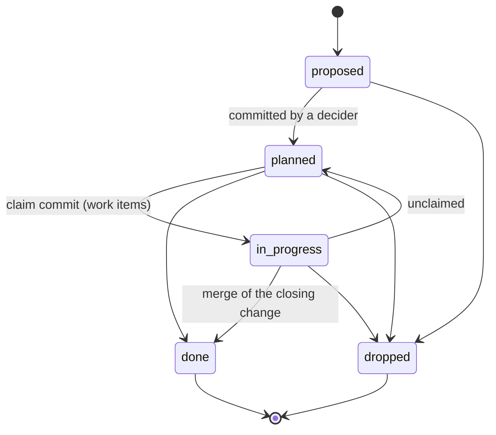

# 3. The core data model

[Back to the index](../0001-human-in-the-lead.md)

The model is independent of any tracker. Adapters map it onto a backend ([3.3](#33-adapter-interfaces)). The in-repo files backend is the reference ([3.4](#34-the-files-backend-the-reference)): every field below has a home there, and other backends are judged by how much of it they can hold.

## 3.0 Principles of the model

These rules decide what the model holds and how. Each rests on an idea in [part 20](20-prior-art.md); [the systems-thinking note](../../systems-thinking.md) explains the ideas at more length.

| # | Principle | Rule | Why |
|---|---|---|---|
| 1 | **Stocks and flows** | Model states and the transitions between them explicitly; derive everything else. | Derived fields cannot go stale, and every queue's stock and flows can be computed ([20.1](20-prior-art.md#201-cybernetics-and-systems-theory)). |
| 2 | **A milestone is a setpoint** | A milestone is a checkable future state with its own "done when"; its unmet constraints are the error the system works down. | A controller needs a setpoint to compare against; a list of tasks gives it none ([20.2](20-prior-art.md#202-control-theory)). |
| 3 | **Good regulator** | A field earns its place only if someone (a person or a controller) acts differently because of it. | A regulator needs a model of what it regulates, and every extra field costs writing, reading and tokens ([20.1](20-prior-art.md#201-cybernetics-and-systems-theory)). |
| 4 | **Near-decomposability** | The tree (project, item) is for accountability; the graph (`needs`) is for dependency; milestones cut across both, many to many. | A hierarchy stays stable when links inside a part are dense and links between parts are few and explicit ([20.1](20-prior-art.md#201-cybernetics-and-systems-theory)). |
| 5 | **Viable system model** | Milestones belong to intelligence: future states set with strategy. Releases are the boundary to the environment. Commitments at that boundary are policy, the owner's. | Each function needs a named owner, and the boundary is where promises to users are made ([20.1](20-prior-art.md#201-cybernetics-and-systems-theory), [part 19](19-viable-system-model.md)). |
| 6 | **Leverage and delays** | A release closes the outer feedback loop through users; a shorter delay from merge to release means faster learning. | Delays make loops slow or unstable ([20.1](20-prior-art.md#201-cybernetics-and-systems-theory)). |
| 7 | **Batch size** | Releases and milestones are batches: keep both thin. | Small batches cut waiting and bring feedback sooner ([20.3](20-prior-art.md#203-queueing-and-flow)). |
| 8 | **Goodhart** | "Every constraint item `done`" is a proxy; a milestone's "done when" is checked independently (a demo, an integration test, a study verdict). | A measure used as a target stops measuring, and authors share blind spots ([20.5](20-prior-art.md#205-measurement), [part 6](06-verification.md#62-independent-verification)). |
| 9 | **Reversibility** | A release is a one-way door for the public interface: a breaking bump is the owner's. Milestone contributions are two-way: agents may cut them within the appetite. Changing a milestone's outcome or its constraints is a decision. | Care goes where undoing is costly, speed where it is cheap ([20.4](20-prior-art.md#204-management)). |
| 10 | **Boundaries** | The version is a message about the interface: the bump is proposed from the interface delta (schemas, CLI JSON, the contract, the report shape), never from internal change. | Users depend on the interface, not the internals ([20.8](20-prior-art.md#208-software-verification-and-delivery)). |
| 11 | **Probes** | A learning milestone is true when its question is answered (a study verdict), not when a feature exists. | Under uncertainty, a probe that settles a choice is worth more than a build that assumes it ([20.3](20-prior-art.md#203-queueing-and-flow), [20.6](20-prior-art.md#206-decision-science-and-human-factors)). |
| 12 | **Outcomes over output** | Build what users want: milestones state outcomes for users, not lists of outputs. | Output is easy to count and says nothing about value ([20.4](20-prior-art.md#204-management)), and a goal is a stronger lever than a parameter ([20.1](20-prior-art.md#201-cybernetics-and-systems-theory)). |

## 3.1 Conventions

- **IDs.** Every tracked entity has a global ID of the form `<KEY>-<n>`, where the key is set per project in `policy.json` (example in this document: `W`, giving `W-214`). Projects, milestones, items and decisions share one number space, so a reference never needs its kind to resolve. Releases are named by their tag (`v0.4.0`). Signals, precedents, studies, runs and ledger entries have their own prefixes (`SIG-`, `P-`, `FB-` for feedback records ([18.4](18-self-improvement.md#184-giving-feedback)), and the evidence source's own IDs) because they live in different stores. ID allocation rules for parallel worktrees are in [3.4](#id-allocation).
- **Stored versus derived.** A field is either *stored* (written by someone, versioned in the backend) or *derived* (computed by scripts from stored fields, the ledger or git history). Derived fields are never written by hand, so they cannot go stale.
- **Classification on everything.** Every entity has a `classification` field ([the security part](10-security.md#103-information-classification)). *As built:* its value is one of four levels, `public`, `internal`, `confidential` or `secret`, and it decides where the entity may be stored. *Decided, not built (HITLD-633, HITLD-636):* the field stays and holds a label, an object with two keys, `readers` (who or what may read the entity) and `reach` (the widest place it may go). The four levels are today's levels, retired after a one-time migration ([Classification levels](#classification-levels)).
- **Untrusted text is marked.** Fields that hold text from outside the project's trust boundary (a reporter's issue body, a contributor's PR description) are typed `untrusted_text`. Agents read them as quoted data only.
- **Times** are ISO 8601 with time zone. They are measurements, never plans.

## 3.2 Entities

### Signal

Anything that arrived. Created by intake, updated by triage.

| Field | Kind | Notes |
|---|---|---|
| `id` | stored | `SIG-<n>` |
| `source` | stored | Intake adapter ID and channel, for example `github-issues:owner/repo` |
| `external_ref` | stored | The source's own reference (URL, message ID) |
| `author` | stored | Contributor ID if known; otherwise the source's handle |
| `received_at` | stored | |
| `body` | stored, `untrusted_text` | Verbatim. Stored where its classification allows |
| `summary` | stored | One or two sentences written by the quarantined normalizer |
| `kind` | stored | `bug`, `feature`, `idea`, `question`, `incident`, `research`, `test-failure`, `burst`, `friction` (works but feels wrong), `worked-well` |
| `area`, `severity`, `reach` | stored | Set by triage |
| `duplicate_of` | stored | Signal or item ID |
| `route` | stored | `auto-fix`, `backlog`, `owner`, `reply`, `closed` with a reason |
| `links` | stored | Items, projects and decisions created from it |
| `provenance` | stored | Ordered list of transforms: who or what touched it and how (normalized by, triaged by, reproduced by, with dispatch IDs) |
| `judgments` | stored | Owner or area-owner judgments on it ([Judgment](#judgment)) |
| `design_refs` | stored | Design sections that already cover the signal (`covers`) or relate to it (`related`), so triage does not file work the design already holds |
| `state` | stored | `new`, `triaged`, `closed` |
| `classification` | stored | From the source's default; raised by triage if needed. *Decided, not built (HITLD-633):* a label with `readers` and `reach`; an unlabeled signal takes its source's label (HITLD-626) |

### Project

A body of work toward an outcome, with its items, its milestones and its appetite. A project being shaped is a `proposed` project: it carries the shaping fields ([part 2, shaping](02-loops.md#23-shaping)). It is the same record before and after the bet.

| Field | Kind | Notes |
|---|---|---|
| `problem` | stored | In the user's terms |
| `signals` | stored | Signal IDs |
| `evidence` | stored | Signals, run and study IDs, research notes with sources and dates read |
| `options` | stored | Each with its trade-offs; always includes "do nothing" with its cost of delay |
| `value`, `confidence` | stored | Value in the project's value units; confidence as a probability |
| `cost_of_delay` | stored | Profile (`standard`, `urgent`, `fixed-date`, `intangible`) and rate; date for `fixed-date` |
| `appetite_tokens` | stored | How big the project is estimated to be, in tokens, from its item estimates (appetite, HITLD-577). Its milestones hold shares of it. What a commitment may spend is a budget, in a signed commitment decision, not this field |
| `out_of_scope` | stored | What is explicitly out |
| `risks` | stored | Known holes the work could fall into |
| `plan` | stored | The plan, or a pointer to a section of a design document |
| `decision` | stored | The decision item whose answer is the owner's bet |
| `bet_by` | derived | Who answered that decision; none until it is answered |
| `judgments` | stored | Carried over from its signals, plus any made on the project itself |
| `revisions` | stored | Each change to value or confidence after shaping began, with its reason and evidence (for example, a study verdict that lowered a judgment's prior) |

Plus the fields common to projects and items ([below](#project-and-item)). The files backend does not store `judgments` and `revisions` yet.

- **The bet.** The owner's bet is the answer to the project's `decision`. It moves the project from `proposed` to `planned` (a commitment of budget, so it is the owner's: [part 4](04-decision-rights.md)). A planned or done project's decision is answered; `hitld work check` refuses one whose decision is still open. A project the owner rejects is `dropped`, with the reason.
- **The appetite.** The project holds it. Each of its milestones holds a share, in its own `appetite_tokens`, and `hitld work check` verifies that the shares of the milestones not dropped fit the project's appetite.
- **No parent.** A project stands alone. A long outcome that spans projects is a milestone with no parent whose constraints are the projects' milestones ([Milestone](#milestone)). The read API's `parent` stays optional on a project; the files backend stores none.

### Judgment

A person's judgment on a signal or a project being shaped. It records an input, not a decision: it raises priority into shaping and never settles anything by itself. The eval scenario `rights/judgement-never-settles-a-call` checks that.

| Field | Notes |
|---|---|
| `what` | What was judged, in plain words (for example, "fits the strategy and is plausibly valuable") |
| `basis` | `gut-check` (a quick call from experience) or `considered` (a deliberate decision with reasons) |
| `by`, `at` | Who and when |
| `weight` | Derived: the prior weight this judgment carries in prioritization, from the person layer and calibration. Kept in the private store |

- **Public and private.** A public entity carries only `what`, `basis` and `by`: what was judged, the basis and who. The time, the weight, the judgment record's fields and the learned weights live in the private store and the person layer ([13.4](13-operations.md#134-settings-in-four-layers)), so nobody can rebuild a person's calibration from public files.
- **Starting weight.** Each person's starting weight per basis is in the person layer, not in the committed `policy.json`. Without one, the design's default applies. The owner's gut checks start **high**: a strong prior, because the owner's experience is real evidence.
- **Calibration.** Outcome checks ([part 2](02-loops.md#210-outcome-sensing)) compare judged items with what happened, per area, and the trust-calibration loop ([part 2](02-loops.md#215-trust-calibration)) tunes the weight from the record: a weight moves only as far as its evidence supports ([23.3](23-people-in-the-lead.md#233-calibration-as-a-prior)). This weighs inputs; it does not grade the person.
- **Not infallible.** When research, a study verdict or measurements conflict with a judgment, the conflict goes to the person who made it, with the evidence and a recommendation. Neither side wins silently.
- **The judgment record.** Optional confidence, what the person expected, the evidence available at the time, and matched outcomes; per-person weights and the calibration review: [part 23](23-people-in-the-lead.md).

### Project and item

The work tree. Projects group items toward an outcome; items are the unit of dispatch. Milestones cut across the tree ([Milestones and releases](#milestones-and-releases)).

**Stored fields common to both** (the files backend stores some under other names and holds several only when `tracker.json` turns them on: [3.4](#file-format)): `id`, `kind`, `title`, `parent` (an item's project; a project has none), `state`, `owner` (who is accountable for the record; optional, and without one it is the owner), `area`, `category`, `classification`, `opened_from` (signal, project or decision IDs), and a body with these sections:

- **Why**: the outcome and who it serves.
- **Done when**: the exit condition, written as checks that can be executed or observed. For work items this is the acceptance criterion ([part 6](06-verification.md)).
- **Plan**: either the plan itself or a pointer to a section of a design document. Briefs point here.
- **Notes**: anything else.

**Additional stored fields on items:**

| Field | Notes |
|---|---|
| `kind` | `work`, `decision`, `external` (below) |
| `needs` | IDs that must be `done` before this item is ready |
| `touches` | Path globs the item is expected to change. Used to predict merge conflicts and serial-file contention |
| `serial` | Serial resources the item needs (`gpu`, a named fixture) |
| `estimate_tokens` | Set at sizing |
| `tier_override` | Optional override from the owner or the shaper. It becomes a profile override (a mode, a starting rung of the cascade or a budget) when tiers give way to execution profiles ([5.1](05-execution.md#51-execution-profiles), HITLD-581, not built) |
| `release_note` | One line for release notes, if the item changes public surface |
| `credit` | Contributor IDs to credit |
| `release` | On a release item only: the version it makes, such as `0.1.0-rc.1` ([Release](#release)) |
| `claimed_by` | Set by the claim commit, on work items only: the dispatch, session or person holding it; the branch and time come from git |

**External items.** An external item is work that someone the system cannot dispatch completes: the owner by hand, a contributor, an upstream project or a vendor. `waiting_on` names who. It is never claimed; it is closed when that work is done ([2.20](02-loops.md#220-upstream-and-the-ecosystem)).

**Lifecycle (stored).** The core lifecycle, stored as `state` in lowercase kebab-case (views show display labels such as "In progress"). Work items use all five states, `in-progress` only on the claim branch. Decisions, external items, milestones and projects use the four without `in-progress`; whether a project is active is derived from its items. `dropped` always carries a reason:



- `proposed` → `planned` is a commitment to do the work. Who may make it is set by decision rights ([part 4](04-decision-rights.md)): the owner for new projects and anything with a public commitment; the orchestrator for items inside a bet project; triage for `auto-fix` bugs within precedent.
- `planned` → `in-progress` happens in the **first commit of the executor's branch** (the claim commit). Because branches are visible across worktrees and, through bundles, across machines, a claim is visible to everyone once the branch exists.
- `in-progress` → `done` rides in **the same change as the work**. Merging the branch is closing the item. There is no separate "close" step to forget.
- **`main` never shows `in-progress`.** The claim commit and the closing commit merge together, so on `main` an item goes from `planned` straight to `done`. `in-progress` exists only on the executor's branch. Which items are claimed is therefore read from branches, not from `main`: `hitld work claims` scans local branches and fetched bundle refs for claim commits. The ledger is the second source: every claim branch should match a dispatch without a terminal event, and every such dispatch should have a claim branch. A mismatch either way is flagged as orphaned (an abandoned branch, or a dispatch that never claimed).
- `dropped` records a reason.

**Derived states and fields:**

| Derived | Rule |
|---|---|
| `claimed` | A live branch has a claim commit for it (`hitld work claims`) |
| `ready` | `planned`, every `needs` entry `done`, no open decision in `needs`, not `claimed` |
| `blocked` | `planned` with at least one `needs` entry not `done`; `blocked_on` lists them |
| `stage` | From the ledger, for items `in-progress`: `briefed`, `started`, `implementing`, `verifying`, `reporting`, `in-review`, `merged` (the fleet view) |
| `critical_path` | Whether the item is on the longest dependency chain (by estimate tokens) to a milestone that needs it |
| `cost_of_delay_rate` | Inherited from the project, plus the rates of everything that `needs` it, milestones included |
| `constraint_of`, `contributes_to` | The milestones whose `constraints` or `contributions` name it. The milestone holds the edge; the item stores nothing |
| `released_in` | The first full release whose record lists it ([Release](#release)); a pre-release does not set it |
| `lead_time`, `blocked_time` | From git history of the item file and the ledger |

### Decision

An item of kind `decision`. It sits in the same tracker, uses the same lifecycle (`proposed` while being framed, `planned` once asked, `done` when answered, `dropped` if mooted), and can appear in any item's `needs`. Open decisions form the **decision backlog**.

| Field | Notes |
|---|---|
| `question` | One sentence that stands alone |
| `context` | Two to five sentences: what is known, what prompted it |
| `options` | Each: a label, what happens, what it costs, whether it is reversible |
| `recommendation` | The option the asker recommends, and why in one sentence |
| `decider` | The owner today. An area owner or a named role may decide once signed answers exist ([Q21](22-open-questions.md), HITLD-36) |
| `rights_basis` | Which decision-rights rule made it theirs ([part 4](04-decision-rights.md)): `one-way-door`, `blast-radius`, `public-commitment`, `novelty`, `conflicting-evidence`, `relationship`, `budget`, `security`, `rule-change` |
| `reversibility` | `two-way` or `one-way` |
| `blocks` | Derived: items that `need` it |
| `cost_of_delay_rate` | Derived from what it blocks |
| `default_if_unanswered` | Only for two-way doors: the option taken, and logged, if the owner sets a deadline and it passes |
| `answer`, `rationale`, `answered_at`, `answered_via`, `answered_by` | Filled on answering. An answer counts by a checkable proof, not by its channel (HITLD-515): the answer record gains a proof field, today the harness-attested turn of the owner in their own session, later the person's signature ([4.5](04-decision-rights.md#45-several-humans-in-the-lead); not built, HITLD-564). Until then answers come only from the owner's own turns in the main session, so `answered_via` records that channel and `answered_by` is `owner` ([Q21](22-open-questions.md)). A decision a precedent resolved has `answered_via: precedent` and no `answered_by` |
| `precedent_offer` | The generalization offered with the question, for the decider to confirm or decline ([Q3](22-open-questions.md)) |
| `precedent` | The precedent created from it, if any |
| `resolved_by_precedent` | If it was resolved automatically, which precedent |

### Milestones and releases

*Accepted and built (HITLD-45): milestone files and release records in the files backend ([3.4](#file-format)), the migration from the old keys, `hitld release propose` and `hitld release make`. The first release waits for it ([Q33](22-open-questions.md#q33-does-the-first-release-wait-for-the-milestone-and-release-format-affects-hitld-24)). Not built yet: `tokens_spent` needs the ledger handed to the tracker, and `cost_of_delay_rate` stays null until a rate is known for a milestone; the milestone graph is HITLD-62.*

A milestone is a future state worth reaching; a release is the record of what reached users. Together they replace the files backend's `milestone` key on items and `milestones` list on projects, and its `priority` key retires ([3.4](#file-format), [Q30](22-open-questions.md#q30-does-the-files-backends-priority-key-retire-with-the-milestone-migration-affects-the-milestone-format)).

**Milestones are never numbered.** A milestone is named by its outcome ("One signal end to end", "Config errors explained"), never "v2" or "phase 3". Order comes from the dependency graph (a milestone may `need` another milestone) and from cost of delay, not from names. A milestone's tracker ID is stable, but it carries no order. No codes, numbers or ordinals appear in a milestone's name or handle: not "M1", not "S2", not "second release"; prose refers to a milestone by name. `hitld work check` refuses a name with a code (M1, S2, v2) or a sequence word with a number (phase 3, stage 2).

#### Milestone

A checkable future state with its own "done when" (principle 2 in [3.0](#30-principles-of-the-model)). It sits under a project and has its own ID in the shared number space. It cuts across the tree: one item may serve several milestones, in several projects (principle 4). A milestone with no parent is a **long outcome**: its constraints are other milestones, so an outcome that takes several projects is one milestone over theirs.

| Field | Kind | Notes |
|---|---|---|
| `id`, `title`, `parent`, `state`, `owner`, `classification`, `opened_from` | stored | As for items. `parent` is a project, or none for a long outcome |
| `kind` | stored | `milestone`, the one kind. A learning milestone (a question gets answered) is the one whose `check` is a study: derived from the check, never stored |
| `outcome` | stored | One sentence: the state for users, or the question answered |
| `done_when` | stored | Clauses, each with a short ID (`c1`, `c2`). Outcome predicates for users where possible ("a new user installs the plugin and dispatches a first item without help"), not lists of outputs. A learning milestone's clause names the study whose verdict settles it |
| `constraints` | stored | **Constraints** (stored as `needs` before HITLD-82): items, or other milestones, without which a clause cannot be true, each linked to that clause. Logical necessity derived from the outcome, not a priority label |
| `contributions` | stored | **Contributions**: items that add to the outcome, each with a `value` and a `confidence`. The value is a positive number in the project's value units ([2.3](02-loops.md#23-shaping), [Q18](22-open-questions.md#q18-what-unit-is-value-measured-in-blocks-shaping-and-prioritization)), the same unit as a project's value, so the milestone's scope can rank contributions by value per token. 1, 2, 3, 5, 8 and 13 are quick choices for the person entering it, not the only values. A learning item's value is the value of information |
| `appetite_tokens` | stored | The milestone's share of its project's appetite: how big it is estimated to be, from its item estimates (HITLD-412, HITLD-577). The shares of a project's milestones must fit the project's appetite, and `hitld work check` verifies it; an item counted in several milestones counts once |
| `deadline` | stored, optional | An external date (an event, a dependency's end of support) with its source, held as a fixed-date cost-of-delay profile. Never an internal estimate ([1.5](../0001-human-in-the-lead.md#15-durations)) |
| `check` | stored | The independent check that the outcome holds: `demo` (a script run by someone other than the items' authors), `integration-test` (a test path) or `study` (a study ID). Each result is recorded with its evidence |
| `unmet_clauses` | derived | The unmet clauses (named `error` before HITLD-82): those with a constraint not `done`, and those the check has not passed. What the system works down |
| `check_due` | derived | Every constraint is `done` and the check has not yet passed |
| `scope` | derived | The contributions kept in scope, by value per token (below). Appetite is now an estimated size (HITLD-577), so how scope relates to a budget is not decided |
| `tokens_spent` | derived | From the ledger, over its constraints and contributions |
| `cost_of_delay_rate` | derived | From the value of its outcome and its deadline profile; passed to every constraint |
| `to_shape` | derived | What shaping still owes it: an outcome, clauses, a check, constraints not yet linked to a clause |

**Constraints and contributions.** The split follows Kano ([20.4](20-prior-art.md#204-management)): must-be qualities are constraints; performance and delight qualities are contributions. There are no priority labels. A MoSCoW-style list becomes constraints (necessity) and contributions (scored value). Scoping is a knapsack, not a negotiation: the constraints' estimates come first, and the rest of the appetite fills with contributions in order of value × confidence per estimate token. If the constraints alone exceed the appetite, the milestone is too big: shaping splits it, or the owner raises the appetite. *Not decided:* appetite now means estimated size, not a limit on spending (HITLD-577), so how scoping and shaping relate to a budget is open. HITLD-577 defines the terms only, and no rule is recorded here; the wording above is from before that change.

**Who changes what** (principle 9):

| Change | Who |
|---|---|
| Commit a milestone (`proposed` → `planned`) | The owner. Design review proposes a bet's milestones, and the owner commits them in the same batched review ([Q31](22-open-questions.md#q31-who-commits-a-bet-projects-milestones-affects-milestones)) |
| Change its outcome, a clause, a constraint or the appetite | A decision |
| Add or cut contributions within the appetite | The orchestrator, as a logged call |
| Mark it `done` | Only a passing check, recorded with its evidence |

**Done means checked** (principle 8). Every constraint `done` is a proxy: it moves the milestone to `check_due`, never to `done`. The check is independent of the items' authors, like an acceptance check ([6.2](06-verification.md#62-independent-verification)): an acceptance author writes it from the outcome and the clauses, before the work starts. A learning milestone is `done` when its study has a verdict, whatever the verdict says (principle 11). The states are `proposed`, `planned`, `done` and `dropped` (with a reason). There is no `in-progress`: items are claimed, milestones are not.

#### Release

The record of what reached users, written when the release is made, as one file per release: `work/releases/<tag>.md` ([Q32](22-open-questions.md#q32-where-does-a-release-record-live-affects-releases)). A release moves items from merged to released: it is the flow out of the merged-but-unreleased stock (principle 1).

| Field | Kind | Notes |
|---|---|---|
| `id` | stored | The tag, for example `v0.4.0` |
| `version`, `previous` | stored | This version and the release before it |
| `bump` | stored | `major`, `minor` or `patch` |
| `interface_delta` | stored | The changes to the public interface ([16.5](16-packaging.md#165-releases-and-compatibility)) since `previous` that justify the bump: schemas, CLI and MCP JSON, the executor contract, the report shape, trailers, adapter interfaces. Each is marked breaking, additive or fix |
| `decision` | stored | The decision or the precedent under which it was made |
| `items` | derived | Items whose closing commits lie between `previous` and this tag, from `Work-Item` trailers. Written into the record when it is made, so readers need no git |
| `notes` | derived | Generated from those items' `release_note` lines, with credit. Written into the record when it is made |
| `milestones` | derived | Milestones whose check passed on the released code |
| `classification` | stored | `public` for a public project. After the migration, a label with readers `public` and reach `anywhere` (HITLD-634) |

A **release item** (the work item that makes a release) carries the version it makes in a `release` key (`release: 0.1.0-rc.1`). Milestones are never named by version; the version lives on the release item, which `need`s what must be finished first: milestones and items. Everything it needs that is not done or dropped is a **gate**: the release waits for it. A milestone is met by its passing check; an item by its state. `hitld work check` refuses a `release` value that is not a version and two release items for one version. `hitld release propose` and `release make` find the release item whose `release` is the version they propose or make, and use it as if `--item` named it; `--item` still overrides, and an item whose `release` is another version is refused. Each gate is listed with its ID, title and state, `release make` refuses while one is open, and the release workflow's record check applies the same rule ([16.5](16-packaging.md#release-mechanics)). With no release item for the version and no `--item`, no gate is enforced.

**When to release.** `main` is always green ([part 14](14-integration.md)), so a release can be cut at any merge. The shipping loop decides when, by weighing the unreleased stock's cost of delay against the cost of a release ([2.7](02-loops.md#27-shipping)). There is no release train by default. A shorter delay from merge to release closes the outer loop through users sooner (principle 6).

**Pre-releases.** A version may carry a pre-release part (`0.1.0-rc.1`, tag `v0.1.0-rc.1`), made with `--pre rc`; each next one counts up (`rc.2`). A pre-release has its record and tag like any release, but it is never the base of a bump: `previous`, the interface delta, the bump and the items are measured from the last full release, so every pre-release of a version and the version itself carry the same bump. A pre-release does not set `released_in`.

**`hitld release propose`** reads the interface delta since the last full release tag and proposes the bump from it alone (principle 10): a breaking change proposes major (minor while the version is 0.y.z, flagged as breaking), an additive change minor, fixes only patch. Internal change, however large, proposes patch at most. With no release tag yet, it says so, and the whole public interface counts as the initial surface: additive, measured from 0.0.0. It drafts the notes, lists items that changed public surface without a changelog line, and lists unmet gates (those of the release item for the version it proposes). The surface it compares is read from each version's own files: the schemas, the command table (each command's arguments, and the top-level fields of its JSON where the command declares `output`), the report shape and trailers named in the contract template, the rest of the contract's wording, and the read API's `api_version`. **Minor and major releases are the owner's** (a one-way door, principle 9): `hitld release make` writes the record and the tag only from the owner's own turn, as decision answers are taken ([Q21](22-open-questions.md#q21-how-is-a-deciders-identity-established-blocks-any-second-human-and-any-channel-other-than-the-local-session)), and never pushes. It makes the release on the main branch from a clean working tree, refuses a version below what the delta proposes, and waits for the gates of the release item for the version it makes (found by that version, or named with `--item`). With `--branch <name>` it writes the record on a new branch from main instead and tags nothing: the owner's squash merge of that release pull request is the release decision, and the release workflow tags the merged commit after the owner approves the run ([16.5, Release mechanics](16-packaging.md#release-mechanics)). A patch release may follow a precedent the owner has confirmed ([2.7](02-loops.md#27-shipping)), because a patch never changes the interface. The record names the precedent in `decision`.

### Precedent

A rule generalized from one or more answered decisions ([part 4](04-decision-rights.md#43-precedent)). A precedent file is Markdown with JSON front matter.

| Field | Notes |
|---|---|
| `id` | `P-<n>` |
| `rule` | "When *conditions*, do *action*." Written in plain language |
| `conditions` | Structured where possible: area, item kind, `rights_basis`, path globs, tags; plus a plain-language condition for what cannot be structured |
| `exceptions` | Cases explicitly not covered |
| `sources` | The decisions it came from |
| `decider` | Who confirmed the generalization |
| `scope` | `all` (the whole project), `area:<name>` |
| `state` | `active`, `retired`. A narrowed precedent stays `active` with its exceptions; the trust event `precedent-narrowed` records the narrowing |
| `applications` | Derived from decisions that cite it |
| `overrules` | Derived: applications the owner later reversed |
| `checked` | Date and policy version when last confirmed still valid |
| `classification` | A precedent drawn from a confidential decision is itself confidential. *Decided, not built (HITLD-628):* it takes the strictest label of its inputs, unless the owner lowers that kind by a signed decision |

### Study, run, verdict

Studies hold empirical questions. **The project's benchmark tool owns them**; this system references them through the evidence adapter ([3.3](#evidence-source)) and does not duplicate them.

- **Study:** a question, a hypothesis, the method, the runs that count as evidence, and a verdict.
- **Run:** one execution of a measurement, with an ID, the commit, the configuration and the results.
- **Verdict:** the answer, citing runs by ID, with what it does and does not establish.

Items and decisions cite runs and studies by ID in their evidence. The learning loop uses the same shape for experiments on the system itself ([part 11](11-metrics-and-control.md#115-changing-the-system)); those **process studies** live in the private store, because they are about the process, not the product.

### Contributor

A person who interacts with the project. Detail in [part 9](09-contributors.md).

| Field | Notes |
|---|---|
| `id` | `C-<n>` |
| `identities` | Handles per source (for example a GitHub login). Emails are stored hashed unless the contributor has a reason to be contacted by email |
| `trust_level` | `L0` to `L4` ([part 9](09-contributors.md#92-trust-levels)) |
| `areas` | Areas they own or regularly contribute to |
| `legal` | DCO sign-off seen; CLA if the project uses one |
| `credit` | Derived: items, signals and reviews credited to them |
| `notes` | Relationship notes. `confidential`; private store only. After the migration, a label with readers `approved-models` and reach `synced-store` (HITLD-634) |

### Area

A part of the project with an owner: `name`, `paths` (globs), `topics`, `owners` (human contributor IDs), `invariants` (pointer into the knowledge base), `reliability` (derived, [part 6](06-verification.md)), `review_rate` (controller-set, [part 11](11-metrics-and-control.md)).

### Ledger entry

Defined in [part 5](05-execution.md#54-the-ledger). Not a tracker entity: it lives in the project's private store, append-only, one file per writer (`ledger/<writer>.jsonl`, HITLD-74), after the single `ledger.jsonl` of before, which is read and never appended to.

### Audit record

Who or what decided each thing, on what evidence, under which rules. One append-only file, `audit.jsonl`, in the private store; one line per decision of any kind. Nothing writes it yet: it is planned for the "Audit trail" milestone.

| Field | Notes |
|---|---|
| `what` | The kind (`decision-answered`, `logged-call`, `precedent-applied`, `precedent-changed`, `controller-move`, `merge`, `release`, `classification-change`, `rule-change`, `quota-exceeded-approval`) and the subject's ID |
| `who` | A human (contributor ID and channel) or an agent (role, dispatch ID, harness, model) |
| `evidence` | Run, study, eval and test IDs; the decision items and precedents cited |
| `under` | The rules it was decided under (named `rule_version` before HITLD-82): the `policy.json` hash, the decision-rights rule that applied, the precedent ID and version, the plugin version |
| `at` | Time |
| `prev_hash` | Hash of the previous line, so any edit to the history is detectable (the chain is hash-linked, not tamper-proof) |

The audit trail links to provenance ([part 6](06-verification.md#64-provenance)): a commit's trailers name its dispatch, and the audit trail names the decisions that dispatch acted under. Public decisions are also visible in the tracker; the audit trail adds the agent-side record and the rule versions, and it is `internal`. *Decided, not built (HITLD-627):* a `classification-change` event records every change of a label; a loosening needs the owner's signed decision with its reason, and a tightening needs none and is recorded all the same.

### Classification levels

Classification is being redesigned. The owner decided its shape on 2026-11-20, in a walk-through recorded as HITLD-625 to HITLD-635 (the taxonomy item is HITLD-620). **None of it is built.** This section gives both: the four levels the code uses today, and the labels that replace them. The four builds are HITLD-636 (labels and the migration), HITLD-637 (clearances and the check), HITLD-638 (enforcement at the commands that return data) and HITLD-639 (places, derived data and loosening). Until the migration has run, every `internal`, `confidential` and `secret` elsewhere in the design names a level of the first table, read through the mapping in [The one-time migration](#the-one-time-migration).

#### Today's levels (as built)

| Level | Meaning | May live in |
|---|---|---|
| `public` | Fine for anyone to read | The public repo, public channels, public trackers |
| `internal` | Project workings with no harm if leaked, but not meant for publication: the ledger, metrics, drafts | The private store; private trackers |
| `confidential` | Harm if leaked: research outputs, relationship notes, unreleased plans, private signals (email, private chat) | The private store only, never sent to a third-party service without the owner's decision |
| `secret` | Credentials and keys | A secret manager only. Never in any artifact, any agent context, or any log |

The four levels sit on one ladder and answer one question: where may an artifact be stored. They do not say which models may read it, which is what the owner needed for a project's measurement results: may it go to a remote model, only to a local one, to no agent at all, and may it leave the machine it was produced on (HITLD-620). They are today's levels, retired after the migration.

Rules for combining them are in [the security part](10-security.md#103-information-classification).

#### Labels and clearances (decided, not built)

**The structure (HITLD-625).** Data carries a **label**; each channel it could flow through (a model, a tool, a storage place) has a **clearance**. A label has two dimensions: who or what may read the data, and where it may go. Data flows only to a channel whose clearance covers the label in each dimension. The rules of the check, and where clearances live, are in [the security part](10-security.md#labels-clearances-and-the-check-decided-not-built).

**Who or what may read it: `readers`** (HITLD-631, amended by HITLD-634 with a sixth value). Written explicitly, with no shorthand, because agents mostly use labels. Widest to narrowest:

| Value | Who or what may read the data |
|---|---|
| `public` | Anyone |
| `any-model` | Any model, from any provider or account (a channel's own clearance still applies) |
| `approved-models` | The models the owner has approved: the owner's own provider account by default, plus any channel the owner has granted |
| `local-model-only` | A local model, and no other model |
| `tools-only` | Tools only; no model sees it |
| `owner-only` | Nobody but the owner |

**Where it may go: `reach`** (HITLD-631). The widest place the data may reach. The classes, tightest first:

| Value | The widest place the data may go |
|---|---|
| `this-machine` | This machine only |
| `synced-store` | The owner's synced private store ([design 0003](../0003-private-store-remote.md)) |
| `bucket-client-encrypted` | A private bucket with client-side encryption |
| `bucket-provider-managed` | A private bucket with provider-managed encryption |
| `anywhere` | Anywhere |

The values are spelled as the build item HITLD-636 proposes them; the owner's decisions give the vocabulary in words (HITLD-631, HITLD-634) and use `readers: approved-models` and `reach: synced-store` as the example of the written form (HITLD-633). The **owner registers concrete places** under a class: this machine, the store, a named bucket. A registration is a recorded decision (HITLD-631, HITLD-639).

**What a label means for each storage backend** (HITLD-623). A measurement tool may own its storage, in a private bucket, instead of using the private store; a label therefore has to say what it means for each backend, not only which channels may carry the data. By the decisions, a label's `reach` is the widest place its data may go, so data may be held in a place of its own class or a tighter one:

| Backend | Its class | Data held there |
|---|---|---|
| This machine's disk | `this-machine` | Data of any `reach`, since this is the tightest place |
| The private store, synced between the owner's machines and encrypted to the devices the owner enrolled ([design 0003](../0003-private-store-remote.md)) | `synced-store` | Data whose `reach` is `synced-store` or wider; data whose `reach` is `this-machine` never enters it |
| A private bucket a tool owns, where the tool encrypts before it uploads | `bucket-client-encrypted` | Data whose `reach` is this class or wider, once the owner has registered the bucket under it |
| A private bucket a tool owns, protected by the provider's own encryption | `bucket-provider-managed` | Data whose `reach` is this class or wider, once the owner has registered the bucket under it |
| A public repository, a public tracker, any public channel | `anywhere` | Only data whose `reach` is `anywhere` and whose `readers` is `public` |

Not decided: the class of a hosted tracker or a third-party chat service, and whether a store pushed to an S3-compatible transport ([design 0003](../0003-private-store-remote.md)) stays the `synced-store` class or counts as a bucket. The nearest items are HITLD-637 (clearances) and HITLD-639 (registered places).

**What carries a label, and the default (HITLD-626).** Entities, files, data areas, tool outputs and ledger events can carry a label. Unlabeled data takes its container's label: a public repository's files are public, a bucket or a store area has its own, and a tool's output takes the tool's setting. With no container, the label is the strictest: readers `owner-only`, reach `this-machine`. (*As built,* an item with no `classification` takes `default_classification` from `tracker.json`, as described under [the file format](#file-format); how that becomes the container's label is not decided in detail, nearest HITLD-636.)

**The written form (HITLD-633).** The `classification` field stays, so that tooling that reads it still finds it, and its value is an object with two keys. The same form is used in front matter, in every command's JSON and in a tool's results:

```yaml
classification: { readers: approved-models, reach: synced-store }
```

The files backend's front matter holds strings and lists of strings only ([the file format](#file-format)); a label is the one object it will hold. How its reader parses that, and what the read API's `api_version` does about it, are left to the build item (HITLD-636).

**Today's levels as a mapping.** The names above replace the four levels in a one-time migration, after which the old names are retired.

##### The one-time migration

| Today's level | Becomes (HITLD-634) |
|---|---|
| `public` | Readers `public`, reach `anywhere` |
| `internal` | Readers `any-model`, reach `synced-store` |
| `confidential` | Readers `approved-models`, reach `synced-store` |
| `secret` | Not a label. Secrets are never stored in HITLD's data, and the guard refuses them |

The sixth reader, `approved-models`, is what keeps `internal` and `confidential` distinct (HITLD-634, amending the five readers of HITLD-631). The migration is a registered step, idempotent, and retires the old names; no entity carries `secret` afterward (HITLD-636).

## 3.3 Adapter interfaces

Four adapter kinds sit between the model and the world: tracker, intake source, notification channel and evidence source. Each is a module in the neutral core with a declared **capability set**, so the system can tell what a backend supports and emulate or degrade the rest. A fifth kind, the **harness adapter**, sits between the core and the agent harness (Claude Code, Copilot, and others) and is specified in [part 15](15-architecture.md#153-layer-3-harness-adapters).

Agents reach adapters through the `hitld` command line, with JSON in and out, or through the MCP server that exposes the same operations ([part 15](15-architecture.md#151-layer-1-the-neutral-core)). Where a harness gives agents a shell, skills use the command line, because a command costs tokens only when called, while every MCP tool's schema sits in the agent's context.

### Tracker adapter

```ts
interface TrackerAdapter {
  capabilities(): TrackerCapabilities      // see below
  get(id: Id): Entity
  query(filter: Filter): Entity[]          // by kind, state, area, needs, parent, text
  create(draft: EntityDraft): Id           // ID allocation per the backend's rules
  update(id: Id, patch: Patch, expectedVersion: Version): Version  // optimistic concurrency
  transition(id: Id, to: State, reason: string, via: ChangeRef): Version
  link(from: Id, relation: Relation, to: Id): void   // needs, parent, duplicate_of, opened_from
  claim(id: Id, claimant: DispatchId, branch: string): ChangeRef
  history(id: Id): Change[]                // for flow metrics: every state change with its time and change ref
  renderViews(): void                      // backends with generated views
}

interface TrackerCapabilities {
  closesOnMerge: boolean          // state change rides with the work (files: yes; hosted: emulated by a merge hook)
  claimInBranch: boolean
  customFields: boolean           // can store needs, touches, estimate_tokens natively
  decisionKind: boolean           // can model decisions as items
  classificationEnforced: boolean // can restrict visibility per entity
  history: 'full' | 'partial' | 'none'
}
```

- **Hosted backends (Linear, Jira, GitHub Issues)** can close an issue on merge (for example through closing keywords), but not in this model's states and trailers, and they have no `claimInBranch`. The adapter emulates both: a merge-queue step transitions items named in merged commits' trailers, and a claim writes a comment and an assignee. Fields the backend cannot hold natively go into a fenced metadata block in the description.
- **Classification.** A backend that cannot restrict visibility per entity (`classificationEnforced: false`) accepts only entities at or below its own level. A public GitHub Issues backend accepts only `public` entities; `internal` and above go to the private store with a stub, or nowhere, per [part 22](22-open-questions.md). *Decided, not built (HITLD-625, HITLD-637):* a tracker backend is a channel with a clearance, and the check compares an entity's label with it on both dimensions, so a public GitHub Issues backend accepts only an entity labeled readers `public` and reach `anywhere`. Whether `classificationEnforced` stays as a capability, and how a hosted tracker's clearance is written, is not decided (nearest HITLD-637).
- **History** feeds flow metrics. With the files backend, history is git history of the item file, which is complete and hash-linked.

### Intake source adapter

```ts
interface IntakeSource {
  id: string                               // e.g. 'github-issues:owner/repo'
  defaultClassification: Classification    // public for a public tracker; confidential for email
  pull(cursor: Cursor | null): { items: RawSignal[], cursor: Cursor }   // for sources without push
  verify(webhook: WebhookRequest): RawSignal[] | Reject  // for push sources (later milestone)
  reply?(externalRef: string, draft: ApprovedReply): ExternalRef        // only with a send approval
}

interface RawSignal {
  externalRef: string
  author: { source: string, handle: string }
  receivedAt: Timestamp
  body: UntrustedText
  metadata: Record<string, string>         // labels, component, attachments as references
}
```

- `defaultClassification` is a level today. *Decided, not built (HITLD-626, HITLD-636):* it becomes the label a signal from this source gets when nothing else labels it, with the one-time migration mapping `public` and `confidential` as in [Classification levels](#classification-levels).
- `pull` is run by the orchestrator at defined points (start of a run, after a merge batch, on the owner's request), never by a polling loop.
- `reply` takes an `ApprovedReply`, a type that can only be constructed by the send gate ([part 9](09-contributors.md#93-replies)), so an adapter cannot send an unapproved draft by accident.

### Notification channel adapter

```ts
interface NotificationChannel {
  id: string                               // 'remote-control', 'slack:#channel', 'push', 'digest-file'
  capabilities(): { buttons: boolean, threads: boolean, max_classification: Classification }
  send(message: Message, urgency: 'interrupt' | 'digest' | 'page'): MessageRef
  ask(question: DecisionQuestion): MessageRef   // answers come back through the main session
}
```

- **Remote Control** is the first channel: the main session is the channel. A question is a message in that session; the owner's answer is the next user turn.
- `max_classification` caps what a channel may carry. A third-party chat service defaults to `internal`; a `confidential` question goes out as a pointer ("a confidential decision is waiting: W-412") rather than its content.
- *Decided, not built (HITLD-635, HITLD-637):* channel clearances live in the owner's person-level settings ([the settings layers](13-operations.md#134-settings-in-four-layers)), and a channel's `max_classification` becomes its clearance there. How a notification channel's clearance is written, and whether a third-party chat service keeps a default (it is `internal` today), is not decided (nearest HITLD-637).
- Quiet hours are enforced by the caller (the question-timing controller), not by each channel.

### Evidence source

```ts
interface EvidenceSource {
  getRun(id: RunId): RunSummary            // commit, configuration, headline results, link
  getStudy(id: StudyId): StudySummary      // question, hypothesis, verdict, cited runs
  startRun?(spec: RunSpec): RunId          // where the tool supports it; a serial resource if it needs the GPU
}
```

A project's benchmark tool is the reference implementation. Executors measure through it (the executor contract says so); this system only records and cites the IDs.

### Private store

The ledger, confidential research, relationship notes, process studies, private signals and judgment records live in a **private store**: a directory outside the repo: `$XDG_DATA_HOME/human-in-the-lead/<project-id>/` when `XDG_DATA_HOME` is set, on every platform; else `%LOCALAPPDATA%\human-in-the-lead\<project-id>\` on Windows (decided, HITLD-245) and `~/.local/share/human-in-the-lead/<project-id>/` elsewhere. A Windows store (or `_machine`) at the old place, `~/.local/share`, is moved once, with a message, the first time its path is resolved, holding a lock for it; while it is in use (executor worktrees, a live run lease, a live resource lock) it stays and is used where it is, so no second store appears. Across volumes it is renamed aside, copied under a temporary name and renamed into place, and a run that finds a move stopped part way finishes it. A store found at both places afterwards (an older release made one at the old place) is merged only where the stray copy holds paths the store lacks; a path at both is left, with the steps to merge it, said once a day. Its interface is a small key-path file API (read, append, write, list) so it can later be backed by something else.

It holds two kinds of data (decided, [Q1](22-open-questions.md#q1-where-does-the-private-store-live-and-do-other-machines-share-it)):

- **Git text files** for what syncs between machines and keeps history: the ledger, decisions, precedents, signals, notes and judgment records. They are the truth.
- **SQLite** (Node's built-in module, so no dependency) for what is local to one machine and needs transactions or fast queries: the machine registry (live executors, leases, locks, capacities, [13.4](13-operations.md#134-settings-in-four-layers)), and an index over the ledger for metrics. The index is a cache: deleting it loses nothing, and it is rebuilt from the text. This is the same pattern as the knowledge base ([part 8](08-knowledge-base.md#82-markdown-in-git-is-the-source-of-truth)). SQLite files are never synced, because two copies written on two machines cannot be merged.

**Moving and syncing the store.** Moving a store by hand would be error-prone, so the command line does it. Executors never run these commands: they refuse when `HITLD_ROLE=executor` or `HITLD_DISPATCH` is set, or in a linked worktree.

- **`hitld store export`** writes one file: a git bundle of the store's text history, plus a manifest (the project ID, the schema versions, and the head it was taken at). The file is encrypted, because the store holds confidential material: in the age format, to one or more public keys, with Node's built-in crypto, so no dependency ([0003 section 10](../0003-private-store-remote.md#10-the-file-format)). SQLite files are never exported: the index is rebuilt, and the machine registry belongs to its machine.
- **`hitld store import <file>`** verifies the bundle and the manifest. It refuses a different project, or a schema newer than this version knows. It fetches into the store, merging the append-only history; a conflict stops the import and says so. Then it rebuilds the index.
- **`hitld store sync <file>`** does both directions, for regular exchange between machines, the same way code bundles move ([13.1](13-operations.md#resuming-on-any-machine)): it imports the file if it exists, then exports the merged store over it. A conflict stops it before the export.
- **`hitld store remote set <url>`, `store push`, `store pull` and `store status`** move the store through a remote instead of a file ([0003 sections 7 and 8](../0003-private-store-remote.md#8-when-sync-runs)). `push` seals the store's committed text as format 2 and pushes it with compare and swap; `pull` opens the remote's head with this device's key and merges it as `import` does. `remote show` prints the address.
- **The remote, as built.** The commands above, `hitld store device init | ask | list | remove` and the run commands' and hooks' own pull and push are built ([0003 sections 6 and 8](../0003-private-store-remote.md#6-enrolling-and-removing-a-device)). The address is never in the repository: it is `HITLD_STORE_REMOTE` in a cloud environment, or the person file on a local machine (`hitld store remote set`), and `policy.json` holds only `store.remote.required`. A push is sealed to the devices the owner approved, each by their own answer to a device decision, recorded inside the encrypted store, and only such a device may push; a new device's request on the store repository is never trusted by itself. A device's private key is in the OS keychain, or, for a cloud environment, in `HITLD_STORE_IDENTITY`. Setting it up, step by step, is the [store remote guide](../../guide/store-remote.md); the offline scenarios are the `store` suite in `evals/scenarios/`, and a test keeps every skill and agent prompt free of keys and store files ([0003 section 13](../0003-private-store-remote.md#13-evals-and-tests)).

As built:

- **The repository.** The store's text parts are a git repository at `<store>/.git`, committed when the store is exported or imported. Its `.gitignore` keeps the machine-local files out: the index (`index.sqlite*`), `run-state.json` and `run/` (rebuilt from the ledger), `primary-checkout.json`, `env/`, `usage/` and `rights/digest.json`. A bundle that carries one of them, a symbolic link or an unsafe path is refused. The machine registry (`_machine/`) is beside the project stores, outside every store's repository.
- **Merging.** Per file: a side that did not change it takes the other side's. When both sides changed an append-only file (`.jsonl`), the lines merge: nothing the common history held may be gone, both sides' new lines are kept, ordered by time so either machine writes the same file, and two different lines with one `id` are a conflict. Any other file changed on both sides is a conflict. A conflict writes nothing and lists the paths.
- **What the file holds.** In every format: the manifest (`project`, `schema_versions`, `head`, `branch`, `created_at`, `hitld_version`) as one line of JSON, then the git bundle.
- **The file, format 2.** What `hitld store export` and `store sync` write. An age v1 file ([age-encryption.org/v1](https://age-encryption.org/v1)): a header with one X25519 stanza per recipient, a header MAC, then the payload in ChaCha20-Poly1305 chunks of 64 KiB. Each file has a fresh random file key, wrapped once per recipient. Any recipient opens it with its own private key, and so does the `age` program. The code is `core/lib/store/age.mjs`, Node's built-in crypto only; it passes age's published test vectors for X25519 and interoperates with the `age` program both ways. A changed header, stanza or payload, a cut stream or data after its end refuses the file, and no plain text is released.
- **The file, format 1.** Read only: `hitld store import` and `store sync` still open it; nothing writes it. A header line of JSON (`file: "hitld-store-export"`, `format: 1`, the cipher, the scrypt parameters, a random salt and nonce), then the AES-256-GCM ciphertext and its tag. The header is authenticated as associated data, so a change to any byte refuses the file. The key comes from a passphrase through scrypt. `store sync` over a format-1 file imports it and writes format 2 back. Another format is refused.
- **Keys.** Export takes each public key (`age1...`) with `--recipient`, once per recipient; public keys are safe on the command line. Import opens format 2 with age private keys (`AGE-SECRET-KEY-1...`, as `age-keygen` writes them) from `HITLD_STORE_IDENTITY` or an open file descriptor (`--identity-fd <n>`), and format 1 with the passphrase from `HITLD_STORE_PASSPHRASE` or `--passphrase-fd <n>` (`0` for standard input). A secret is never taken from an argument, which would land in shell history and process lists. Where each device keeps its key, and the list of enrolled devices, are [design 0003](../0003-private-store-remote.md) sections 5, 6 and 9.
- **git** runs with an argument list, pinned to the store (`GIT_DIR`), with the owner's global and system git config ignored and hooks off (`core.hooksPath=/dev/null`). A bundle is checked with `git bundle verify` and its head against the manifest before it is fetched, with `transfer.fsckObjects`. Nothing from a bundle runs.

## 3.4 The files backend (the reference)

The default backend stores the tracker in the repository, one file per entity. It follows a plain, widely usable shape: one file per item, global `<KEY>-<n>` IDs, and front matter that holds data only.

### Layout

```
work/
  projects/
    W-2-config-parsing.md        # one file per project, shaped or planned
  items/
    W-3-reject-unknown-keys.md   # one file per work item, decision or external item
  milestones/                    # one file per milestone
    W-1-a-usable-command-line.md # a long outcome: no parent
    W-4-config-errors-explained.md
  releases/                      # one record per release, named by its tag
    v0.4.0.md
  views/                         # generated, never edited by hand
    ready.md
    blocked.md
    decisions.md                 # the decision backlog
    critical-path.md
    milestones.md                # each open milestone: error, scope, check due, what shaping owes it
    unreleased.md                # the merged-but-unreleased stock
    projects.md
    lists.md
    items-graph.md               # dependency diagrams
    projects-graph.md
precedents/
  P-1-dependency-licenses.md     # public precedents; confidential ones live in the private store
signals/
  SIG-1-definition-of-ready.md   # public signals, when the project keeps them in the repository
```

**Signals in the repository.** By default signals live in the private store ([part 10](10-security.md#103-information-classification)). A project may keep its **public** signals in the repository instead (`intake.public_signals_in_repo: true`), one file per signal with the fields above as front matter and the body as the text. This repository does, so its own intake is visible.

The work directory, the folder names, the views directory and the ID key are settings (`tracker.json` and `policy.json`), so a project with an existing tracker in a different place maps onto this layout by configuration, not migration.

### Who owns the format

The plugin owns the file format; a project that uses it depends on the format, never the other way round. Three rules keep the project free to change its own side without touching the plugin.

- **Writes go through the plugin** (`hitld work new`, `claim`, `close` and others), so the lifecycle, claim and validation rules always apply. A project's own tracker scripts become thin wrappers over `hitld` or are retired ([part 16.7](16-packaging.md#167-adopting-an-existing-in-repo-tracker)). A `hitld work patch` command for editing fields is planned.
- **Reads go through a versioned JSON read API**: `hitld work query --json` and `hitld work show --json` carry an `api_version` in every response, with the entities and the declared fields (`declared_fields`: name, type, list, description). Anything else that reads the tracker (a board, custom views, reports) reads this output, never the files, so a change to the files that keeps the API stable breaks no reader. Without `--json` the commands print the same JSON without the version promise. **The rule for `api_version`:** it starts at 1; removing, renaming or retyping a field raises it; adding a field does not, so readers ignore fields they do not know. The version is `API_VERSION` in `core/lib/tracker/files/api.mjs`.
- **Extension by declaration.** `optional_keys` in `tracker.json` turns on a fixed list of extra keys. For a project's own fields, `tracker.json` also takes `fields`: each has a `name`, a `type` (`string`, `integer`, `number` or `boolean`), `list` (true for a list of that type), optional `values` (the allowed texts of a string field) and a `description`. A declared field is validated against its type by `hitld work check` and by every write, kept when the tool rewrites a file, returned typed in the read API and matched in queries (`hitld work query --field name=value`; a list field matches when it holds the value). A name the format already uses, or a key that names code to run, is refused. The file holds the value as text; the read API types it. An undeclared key is still an error.

Structural changes (a new state, a new kind, different claim or readiness rules) are plugin changes: a schema version bump with a migration. `hitld work migrate` applies the migrations to the tracker's files. A migration is a registered, named step: a function from the files to the changes that bring them to the new format, which returns no changes for a file already in it, so a second run does nothing. `--dry-run` prints each file's diff and writes nothing; a real run checks the result, writes it and commits it as one commit (`--no-commit` leaves the files in the working tree); `--only <name>` runs one step; only the orchestrator runs it. When a registered migration still has work, `hitld work check` names the files. The registered migrations are `milestone-entities` (each project's `milestones` list and each item's `milestone` key become milestone files, with those items as constraints marked `c?` for shaping to link to clauses), `retire-priority` (removes `priority`, [Q30](22-open-questions.md#q30-does-the-files-backends-priority-key-retire-with-the-milestone-migration-affects-the-milestone-format)), `names-and-states` (HITLD-82: the lifecycle key is `state` with lowercase kebab-case values, and the other renamed keys in [File format](#file-format)) and `tracker-structure` (HITLD-90: each initiative becomes a milestone with no parent, with the same ID, whose constraints are the milestones of its projects, marked `c?`; every milestone gets `kind: milestone`; a project's `initiative` key goes; an opportunity becomes a proposed project). A step that creates a file takes its number above every ID in the tracker and every number another branch, worktree or bundle ref of the clone already holds. A conformance suite (`core/lib/tracker/conformance.mjs`) checks any backend against the tracker interface through the interface alone, with declared fields: a backend that drops, retypes or refuses a declared field fails. The files backend runs it in the test suite; another backend (a hosted tracker, an adapter behind the same interface) runs the same module.

### File format

Markdown with YAML front matter. The front matter is **data only**: the schema lists every allowed key, and the check script rejects unknown keys. No key is ever executed. Some trackers support fields or hooks that run commands when an item changes; this format excludes executable keys by schema ([part 10](10-security.md)), and the check refuses keys such as `hooks`, `script` and `run` by name.

The stored keys take the model's names (HITLD-82), except the parent: the files backend stores `project` (the parent of an item or a milestone), which the read API returns as `parent`. A project has no parent key. It also stores `claimed_by` (who holds a claim) and `created`, which the model does not list. Before HITLD-82 the format stored `status` (with the values `Proposed`, `Planned`, `In progress`, `Done`, `Dropped`), `claimed`, `decided-by`, `lead`, `party`, `tier_hint`, `changelog`, a milestone's `needs` and the check result `verdict`; the migration `names-and-states` moves them, the check names a file that still holds one, and claim branches, file history and release tags from before are read in the new names. The keys `milestone` (on items), `milestones` (a project's list of names) and `priority` are retired: milestones are their own files, and order is derived, with an owner's direct reorder a recorded decision ([Q30](22-open-questions.md#q30-does-the-files-backends-priority-key-retire-with-the-milestone-migration-affects-the-milestone-format)). The check names a retired key and points to `hitld work migrate`. Before HITLD-90 the format had the kinds `initiative` (in its own folder, `initiatives/`), `capability` and `learning`, and the model had `opportunity`; a project stored its parent as `initiative`. The migration `tracker-structure` moves them; until the next minor release the check names a file that still holds one, and claim branches, file history and release tags are read in the new form. `bet_by` is never stored: it is derived from the project's decision. These keys are always allowed:

| Kinds | Keys |
|---|---|
| work, decision, external | `id`, `title`, `kind`, `state`, `created`, `project`, `owner`, `needs`, `reason`; work items add `claimed_by` and `release` (a version: one work item per version); decisions add `decider` and, once answered, `answer`, `rationale`, `answered_at`, `answered_via`, `answered_by`, `precedent` and `resolved_by_precedent`; external items add `waiting_on`. An item's `needs` may name items and milestones |
| project | the common keys plus `owner`, `plan`, the shaping keys `problem`, `signals`, `evidence`, `options`, `value`, `confidence`, `cost_of_delay`, `appetite_tokens`, `out_of_scope`, `risks`, and `decision`, `reason` |
| milestone | the common keys plus `project` (none for a long outcome), `owner`, `outcome`, `done_when`, `constraints`, `contributions`, `appetite_tokens`, `deadline`, `check`, `check_results`, `reason` |
| release record (`releases/<tag>.md`) | `id`, `version`, `previous`, `bump`, `interface_delta`, `decision`, `items`, `milestones`, `classification`; the body holds the notes |

The front matter holds strings and lists of strings only (*decided, not built (HITLD-633):* with one exception, the `classification` label, an object with two keys), so each structured milestone entry is one line of text in a fixed form, and the read API returns it typed:

| Key | One entry |
|---|---|
| `done_when` | `c1: <text>` |
| `constraints` | `<ID> c1` (a constraint linked to clause `c1`), or `<ID> c?` (to be linked at shaping) |
| `contributions` | `<ID> value=<number above 0> confidence=<0 to 1>` |
| `check` | `<demo, integration-test or study> <target>` |
| `check_results` | `<pass, fail or answered> <YYYY-MM-DD> <role>: <evidence>`, oldest first (`answered`: a learning milestone's study has a verdict) |
| `deadline` | `<YYYY-MM-DD> <source>` |
| `options` (project) | `<label>: <trade-offs>` |
| `cost_of_delay` (project) | `<standard, urgent, fixed-date or intangible>[ rate=<number>][ date=<YYYY-MM-DD>]`; `fixed-date` needs its date |
| `interface_delta` (release) | `<breaking, additive or fix> <area>: <what>`, where the area is `schemas`, `cli`, `contract`, `report`, `trailers`, `read-api` or `adapters` |

A decision's question, context, options, recommendation, precedent offer, rule basis and reversibility are text for the decider, so `hitld rights ask` writes them into its body under the reference sections (Question; Options and recommendation; Answer), not into the front matter. The private store keeps the options it was asked with, so an answer such as "A" is read against them. A decision item is filed under a project like any item: the question names it as `parent`. A question classified above the tracker's `default_classification` is refused unless `classification` is in `optional_keys`, so it is never written as public.

A milestone is `done` only when its latest pass or fail in `check_results` is a pass by a role that wrote none of its items (the roles in its items' commits' `Agent-Role` trailers, and always `executor`); a learning milestone (its check is a study), when `answered` is recorded by such a role. The check and the tracker refuse anything else.

Project-specific fields are declared in `tracker.json` `fields` ([Who owns the format](#who-owns-the-format)). The other fields of [3.2](#project-and-item) (`area`, `category`, `classification`, `opened_from`, `touches`, `serial`, `estimate_tokens`, `tier_override`, `release_note`, `credit`) are off until `optional_keys` in `tracker.json` lists them. `owner` is always allowed: a record without it is the owner's. An item with no `classification` key takes `default_classification`. *Decided, not built (HITLD-626):* unlabeled data takes its container's label, and with no container the strictest.

```markdown
---
id: W-214
kind: work
title: Reject unknown keys in the config file
project: W-201
state: planned
created: 2026-03-02
needs: [W-209, W-213]
---

## Why
A misspelt key in the config file is silently ignored, so users think a setting took effect.

## Done when
- `test/config/unknown-keys.test.ts` passes, including the case of a key nested in a table.
- Running the tool on a config with an unknown key exits with status 2 and names the key and its line.

## Plan
docs/design/0012-config-parsing.md#3-validation

## Notes
```

With `optional_keys` set to include `area`, `touches` and `estimate_tokens`, the same file could also carry `area: config`, `touches: ["src/config/**", "test/config*"]` and `estimate_tokens: 180000`.

### Claims and closing

- **Claim.** The executor's branch starts with one commit that changes only the item file: `state: in-progress` and `claimed_by: <dispatch, session or handle>`. Commit message: `claim: W-214`. The branch and the time of the claim are read from git, not stored in the file. Two executors cannot both claim one item without one of the claim commits failing to merge cleanly, because both change the same lines.
- **Close.** The final commit of the branch (or any commit in it) sets `state: done`. Merging the branch closes the item. If a branch is abandoned, the orchestrator gives up the claim (`hitld work unclaim`) with a commit on `main` whose message starts `unclaim:` and carries `Claim-Branch:` and `Claim-Commit:` trailers and the reason. The commit may be empty, because `main` already shows the item `planned`. A claim whose commit an unclaim commit names stops counting; the scan still reads the `release:` commits made before HITLD-82.
- **Trailers.** Every commit an executor makes carries git trailers: `Work-Item: W-214` and `Dispatch: D-…`, plus `Agent-Role`, `Agent-Model` and `Agent-Effort` (decided: [Q5](22-open-questions.md)), and the other provenance trailers in [part 6](06-verification.md#64-provenance). Hosted backends use the same trailers to emulate close-on-merge.

- **Work that does not come through an executor** (a person fixes something by hand and merges it). Closing still rides with the work, but it can be asked for with a structured trailer instead of an edit: a commit carrying `Closes: W-214` has the local merge queue add the `state: done` edit to the item file in the same merge, in queue and owner mode alike, so the close is as atomic and as revertable as an executor's. Through pull requests (`merge.via: pull-request`) it does not: GitHub squash-merges the branch, a `Closes:` trailer is ignored, the squash message does not keep it, and the check on `main` below does not see it either. `Refs: W-214` links a commit to an item without closing it. Free text in commit messages is never parsed for keywords ("fixes", "closes"): prose misfires, and a trailer is explicit. The queue commits the edit on top of the branch's own commits, before the fast checks and the suite, so they cover it; the edit changes the `state:` line and no other byte of the file. A branch a dispatch made closes only its own item; one made by hand may close any planned or in-progress work item. A `Closes:` the queue cannot honor (no such item, not a work item, one that is proposed or dropped, another item than a dispatch's own, or a value in this tracker's key that is not an ID, such as `W-214.` or `W-0214`) sends the branch back. A value in another key (`Closes: #57`, for a forge) is not HITLd's and is left alone. `hitld merge` always does this; there is no setting to turn it off.
- **Consistency on `main`.** `hitld work check` flags two mismatches: a commit on `main` carries `Work-Item:` or `Closes:` for an item that is still open, and an item went to `done` with no commit referencing it. It warns rather than fixing silently, and the orchestrator offers the fix. A commit that reached `main` outside the merge path (a direct push) is caught the same way, at the next check. These rules keep the warnings true:

  - An open item whose file changed after the commit (a revert, a reopening, a note on why it stays open) is not flagged. "After" is graph order (`git log --topo-order`), which is approximate across merge commits, and a renamed item file counts the rename as a change: one more reason these are warnings.
  - A `Work-Item:` trailer on a commit that changes only tracker files is the tracker's bookkeeping (`hitld work publish`, a claim), not a reference to work.
  - A commit that carries work also names an item through its subject in this project's forms: a lead such as `W-214: ...`, `W-214, 215: ...` or `W-214 to 216: ...`, or an end such as `... (W-214)`, before a squash merge's `(#N)`. A squash through a pull request often keeps no `Work-Item:` trailer. A subject only names: it never closes, and it never makes an item open-with-a-commit.
  - A done item whose file has not changed since the first commit on `main` that names an item in a trailer predates the trailers and is not checked. A commit that changes more than five item files is a bulk edit of the tracker (a migration, a reshaping) and does not count as a change to any of them.
  - A release item is left out: it is done when its release is published, which the release check governs.
  - In a shallow clone, the done-without-a-commit kind is skipped and the check says so.
- **Why not keyword closing.** Hosted trackers parse commit messages because their state lives outside the repository. Here the state is in the repository, so the close is part of the diff: it happens exactly when the work merges, it is reviewed with the work, and reverting the merge reopens the item.

### ID allocation

Parallel worktrees and additional orchestrators (another machine, a cloud session) make naive "next number" allocation collide. Rules:

1. **Only the orchestrator allocates IDs**, on `main`, in its own working tree. Executors never create tracker entities; when they find new work, they describe it in their report's questions or follow-ups, and the orchestrator creates the items.
2. **Every other orchestrator allocates from its own reserved block**: a range recorded in `policy.json` (for example, numbers from 100000 upward). Blocks never overlap, so items created by any orchestrator merge without renumbering.
3. **The number comes from a source every session shares**, not only the local checkout. Two sessions on two machines each have their own copy of `main`, and the next free number in one copy may be taken in the other, in a file not yet pushed.
   - **The store counter.** When the private store has a remote ([design 0003](../0003-private-store-remote.md)), the number is taken from a counter on the store repository: the `hitld-ids` branch holds `ids.json`, the highest number taken per key and block. A create reads the branch's tip, raises the counter to at least the next number free here, and pushes that commit on top of the tip, never forced. The push is the compare and swap: when another session took a number first, git refuses it, and the create reads the new tip and tries again. The number is taken before the file is written. A counter that cannot be reached refuses the create (`id-counter-unreachable`) and writes nothing.
   - **Origin.** Every create first fetches the remote `main` tracks, so the numbers on its `main` and on every open branch it holds count with the local ones. A number in use there is never given out, even when the counter is behind. A fetch that fails is a warning in the result (`hitld work new` prints it); the numbers last fetched still count.
   - Without a store remote, origin alone is checked.
4. **The check fails on duplicate IDs**, as a backstop: `hitld work check` names both files (`--branches` also across worktrees and branches), and the merge queue refuses a branch whose rebased tree holds two items with one ID, naming both files, whatever the fast checks are.

The counter is on the store repository because it is the one place every session of a project can already write with compare and swap: every device that keeps the store reaches it, and its push is refused when the tip moved. Origin alone is not enough, because a session files an item in its working tree and pushes it later, often in a batch, so two sessions can both take a number neither has pushed. The counter holds numbers only, nothing about the items, and it is not trusted: anyone who can write the store repository could move it. A number set too high leaves a gap; one set too low is caught by the origin check. `hitld work new` reports which source the number was checked against (`id_source`: `store-counter`, `origin` or `local`).

Sequential IDs are decided ([Q2](22-open-questions.md)): people say and type these IDs, often from a phone, and agents copy short numbers more reliably than random strings. Item creation is already centralized in the orchestrator, so the main benefit of hash IDs is not needed.

### Generated views

`views/` is regenerated by a script from the item files. **Only a merge commits views**, on `main`: the merge queue after each batch, or, in owner merge mode (`merge.mode: owner`), the merge the owner approves; executor branches never touch `views/`, so parallel branches do not conflict there, and the per-branch check skips view freshness. The batch check fails if any item references an ID that does not exist. Views are committed so they can be read on GitHub and on a phone without running anything.

The views include `milestones.md`: a mermaid graph with milestones as nodes and `needs` between milestones (a milestone's constraints that name other milestones) as edges, each node showing its outcome, its constraints `done` out of all, tokens spent against its appetite, and its check (passed, due or not yet due), with the critical path highlighted; under it, a table of the same fields with each milestone's constraints and contributions and their state; then each milestone's unmet clauses, scope and what shaping still owes it ([12.1.2](12-reporting-and-limits.md#1212-the-milestone-graph)). Tokens spent come from the private ledger, so this view shows them as —. It complements `items-graph.md`, which shows items and their `needs`.

### Validation

The check script verifies, on every merge batch:

- every file matches the schema for its kind, with no unknown keys;
- every reference (`parent`, `needs`, `constraints`, `contributions`, `opened_from`, `precedent`, and a release record's `previous`, `items` and `milestones`) resolves;
- every milestone constraint names a clause that exists (or `c?`), every contribution has a value and a confidence, and a `done` milestone has its passing check;
- no milestone name is numbered (M1, v2, phase 3);
- a project's shaping fields parse, a planned or done project's `decision` names an answered decision item, and its milestones' shares fit its appetite;
- no dependency cycles, through items and milestones;
- no entity above `public` classification in a public repository;
- no item on `main` is `in-progress` (a claim committed directly to `main` is an error);
- claim branches and open ledger dispatches match, or the mismatch is flagged as orphaned;
- views are current (batch check on `main` only).
