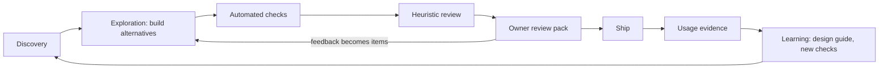

# 7. UX design and review

[Back to the index](../0001-human-in-the-lead.md)

Verification ([part 6](06-verification.md)) establishes that a change is **correct**. This loop establishes that it is **good to use**. They are different kinds of evidence, and passing one says nothing about the other.

**Developer experience is UX.** For a library, the users are developers and the interface is the API: its names, its shapes, its error messages, its examples and its documentation. Everything in this part applies to them.

## 7.1 The loop

| | |
|---|---|
| **Queue** | Items with user-facing change (`ux: true`, set at shaping or by path rules for UI and public API files) |
| **WIP limit** | Owner review packs outstanding (`ux.review_packs_max`); the owner's taste is the constraint |
| **Sensors** | Automated-check failures; heuristic findings by severity; owner review turnaround; post-ship usage evidence (where people get stuck, support questions, API misuse) |
| **Controller** | When review packs pile up, `ux.alternatives` drops toward one; when a finding recurs, it becomes an automated check |
| **Escalation** | New patterns, brand and look, and public-facing changes go to the owner; conformant changes within established patterns do not (7.8) |

## 7.2 Discovery

Who the users are, what jobs they are doing, and what evidence says about them: signals from intake, research findings and briefs ([part 2](02-loops.md#23-shaping)), and usage evidence from earlier releases. For developer experience, discovery looks at **the code people write against the API**: examples, issues showing misuse, questions in discussions, and downstream code where it is public.

## 7.3 Exploration: build, then compare

Exploration builds **alternatives in context**, in the real product, rather than asking for approval of mockups, and compares them:

- for a screen or flow, **one build by default**. Two or three working variants (`ux.alternatives`, default 3 for the cases below) are built only for a new pattern or for an item the owner flags, behind a switch, in separate worktrees or as a spike;
- **for an API, sample code against each candidate shape**: the same three or four realistic tasks written against each, so the comparison is about the code users would write, not about the declarations.

Alternatives are cheap when agents build them, but each one costs the owner a review. Within established patterns, the loop builds once.

## 7.4 Automated checks

| Check | What it catches |
|---|---|
| **Accessibility** (axe-core, against WCAG 2.2) | Missing labels, contrast, roles, focus order; cases the tool cannot decide are reported as incomplete, for a person to review |
| **Both themes, narrow widths, keyboard use, a clean console** | Unreadable dark mode, overflow at phone width, keyboard traps, console errors and warnings |
| **Design-system conformance** | Use of the project's own tokens, components and spacing, configured per project in `policy.json` (`ux.design_system`) |
| **Visual regression** against approved images (for example Playwright's screenshot comparison) | Unintended visual change; intended changes update the approved images in the same branch, for the owner to see |
| **API consistency rules** | Naming conventions; sync against async; cancellation; resource lifetimes and disposal; error types; parameter order; configured per project |
| **Idiom checks** against comparable libraries | Shapes that surprise users of the language or ecosystem (for example, against published API guidelines for that ecosystem) |

Checks run at merge, in either merge mode, for items with `ux: true`. A failure is a verification failure like any other.

## 7.5 Heuristic review

One pass by a reviewer agent, against established usability heuristics (Nielsen's ten heuristics; for APIs, the cognitive dimensions as adapted to API usability) and the project's own design guide. Findings have a severity (cosmetic, minor, major, blocking) and a location. Blocking and major findings go back to the executor; minor and cosmetic findings are batched as items. One pass, not a loop: a second pass on the same change is spent only if the first found blocking problems.

## 7.6 Owner review, made phone-friendly

The owner judges taste and feel. Automated checks settle correctness and conformance. Area owners judging look in their own area comes later, with signed answers ([part 4.5](04-decision-rights.md#45-several-humans-in-the-lead), [Q21](22-open-questions.md)). So the owner gets a **review pack**, generated per change:

- screenshots in both themes and at phone width, or a short recording of the flow;
- for a public item only, a link to a published, clickable page of the change;
- for APIs, the sample code for each candidate shape side by side;
- what changed, in two or three lines;
- **the specific judgement calls** the owner is being asked, each as a question with a recommendation ([part 4](04-decision-rights.md#the-decision-question)).

**A pack is an artifact with a classification.** Screenshots and recordings can show confidential information as readily as text can, so a pack is not safe by default.

- A pack takes the highest classification of anything it shows: the item, the data on screen, and the code ([high-water mark, part 10](10-security.md#rules)).
- It goes only through channels whose ceiling covers that classification ([per-service ceilings, part 10](10-security.md#rules)). This holds for a published page and for screenshots alike.
- A published, clickable page is for public items only.
- For anything above public, screens are rendered from fixture or synthetic data in preference to real data, and the pack says so.
- Packs are stored in the private store unless they are public.
- An agent that cannot show the change within these limits says so and asks how the owner wants to review it.

The pack is built to be judged on a phone in a minute or two. The owner's feedback becomes items; their answers on look and pattern become precedent in the design guide.

## 7.7 After shipping and learning

- **Usage evidence**, through outcome sensing ([part 2](02-loops.md#210-outcome-sensing)): where people get stuck, support questions, API misuse in issues and public downstream code.
- **Learning.** Owner decisions on look and patterns join the project's **design guide** (a knowledge-base page) as precedent. A heuristic finding that recurs becomes an automated check, so the reviewer's attention moves to new kinds of problem.

## 7.8 Decision rights

| Change | Decider |
|---|---|
| A new pattern, component or interaction model | Owner |
| Brand, look, tone of voice | Owner |
| Public-facing changes: a new screen, a new public API, a renamed public symbol | Owner (also a public commitment, [part 4](04-decision-rights.md#42-when-the-owner-is-involved)) |
| A change within established patterns that passes every check | No escalation; the owner sees it in the digest |
| A look call that is cheap to undo and in no other way the owner's | Two-way doors default to action ([part 4](04-decision-rights.md)): the holder decides, logs it, and the owner sees it in the digest |
| Fixing a check failure or a heuristic finding | The executor |

## 7.9 Evals

The eval suite ([part 17](17-evals.md)) includes UX scenarios:

- **seeded usability problems** in fixture screens and flows (an unlabeled control, a keyboard trap, an error message with no next step, an inconsistent term): does the heuristic reviewer find them, at what severity, with how many false findings;
- **seeded API inconsistencies** in a fixture library (a mixed naming convention, an async method without cancellation, a leaked resource): does the API checker catch them;
- **review packs**: does a generated pack contain the judgement calls, and fit its size budget.

Sources (links and dates as cited; check each before relying on it): Jakob Nielsen, "10 Usability Heuristics for User Interface Design" (first published 1994; the page has been updated since), <https://www.nngroup.com/articles/ten-usability-heuristics/>; T. R. G. Green and M. Petre, "Usability Analysis of Visual Programming Environments: A 'Cognitive Dimensions' Framework", _Journal of Visual Languages and Computing_ (1996), DOI 10.1006/jvlc.1996.0009; Steven Clarke, "API Usability and the Cognitive Dimensions Framework", an archived Microsoft blog post, <https://learn.microsoft.com/en-us/archive/blogs/stevencl/api-usability-and-the-cognitive-dimensions-framework>; WCAG 2.2, <https://www.w3.org/TR/WCAG22/>; axe-core, <https://github.com/dequelabs/axe-core>. Other ideas the design uses are in [part 20](20-prior-art.md).
