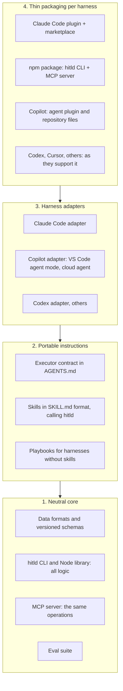

# 15. Architecture and portability

[Back to the index](../0001-human-in-the-lead.md)

The system must run under more than one agent harness: Claude Code first, then GitHub Copilot, then OpenAI Codex, Cursor and others. So the architecture separates what is the same everywhere from what depends on the harness, in four layers. Everything above the harness adapter is written once.



**The rule that keeps it portable:** the core never calls a harness. It knows only the harness adapter interface (15.3). Adding a harness means writing an adapter and its packaging; it never means changing the core, the schemas or the skills. The core's own tests run against a fake adapter, so a core change that leans on one harness fails them. The adapter interface and capability set are public interface under semver ([16.5](16-packaging.md#165-releases-and-compatibility)), labelled experimental until a second adapter proves their shape.

## 15.1 Layer 1: the neutral core

| Part | What it holds |
|---|---|
| **Data formats and schemas** | Items, decisions, precedents, signals, ledger lines, studies, `policy.json`, reports, eval scenarios and results. JSON Schema files, each with a `schema_version` ([part 16](16-packaging.md#165-releases-and-compatibility)) |
| **`hitld` command line and Node library** | All the logic: tracker adapters, rights rules, precedent matching, the ready queue, dispatch planning, the merge queue's checks, the ledger, metrics, controllers, the `kb` tool, intake normalization, the send gate. The command line is a thin wrapper over the library, with JSON in and out |
| **MCP server** (planned) | `hitld mcp` will expose the same operations as MCP tools, generated from the same command table, so the two can never drift. Tools only, no MCP resources or prompts, because the Copilot cloud agent supports only tools |
| **Eval suite** | Scenarios, fixtures, graders and the runner ([part 17](17-evals.md)) |

**Command line or MCP.** Both exist; each harness uses the cheaper one it supports. Wherever there is a shell (Claude Code, Copilot in VS Code, Codex, Cursor), skills call the command line, not MCP: a command costs tokens only when called, while every MCP tool's schema sits in the agent's context for the whole session. Where an agent has tools but no general shell access the project allows (the Copilot cloud agent, behind its firewall), it uses the MCP server, configured with an explicit tool allowlist.

The core is Node.js with no third-party runtime dependencies ([part 16](16-packaging.md)).

## 15.2 Layer 2: portable instructions

### The executor contract in AGENTS.md

`AGENTS.md` is the cross-tool convention for project instructions, read natively by Codex, Cursor, Copilot in VS Code and the Copilot cloud agent (15.7). The executor contract ([part 5](05-execution.md#the-executor-contract)) lives there, between markers, so every harness's executors see the same rules.

**How Claude Code picks it up.** Claude Code reads `AGENTS.md` as project instructions only when there is no `CLAUDE.md` in the working directory or above it. A project that has a `CLAUDE.md` must import it with a line `@AGENTS.md` in `CLAUDE.md` (the documented approach; a symbolic link also works but causes problems on Windows). `hitld check contract` verifies that the contract block is present and current in `AGENTS.md`, and that a `CLAUDE.md`, if present, imports it.

### Skills in the Agent Skills format

Procedures live in skills, in the open `SKILL.md` format (Agent Skills, agentskills.io), which Claude Code, Copilot (VS Code and cloud agent), Codex, Cursor and Gemini CLI all read (15.7).

- **Portable front matter only** in the core skill files: `name`, `description`, `license`, `compatibility`, `metadata`, `allowed-tools`. Those are the fields every reader accepts; some surfaces reject unknown fields with an error. Harness-specific fields (Claude Code's `model`, `effort`, `context`, `agent`) are added by that harness's packaging step (layer 4), not written into the source.
- **Skills call the core**, by command (`hitld …`) or MCP tool, never a harness feature. "Dispatch an executor" in a skill is a `hitld dispatch` call that the harness adapter carries out, not an instruction to use a particular harness's subagent tool.
- **Locations.** `.agents/skills/` is read by Copilot in VS Code, Codex, Cursor and Gemini CLI; Claude Code reads skills from plugins and from `.claude/skills/`. Packaging places the same files where each harness looks.

### Playbooks for harnesses without skills

A harness that does not read skills gets the same files as playbooks: `AGENTS.md` links to them by path ("To triage signals, follow `.agents/skills/triage/SKILL.md`"), and the agent reads the one it needs. Same text, loaded by link instead of by the harness.

## 15.3 Layer 3: harness adapters

### The interface

```ts
interface HarnessAdapter {
  id: string                                   // 'claude-code', 'copilot-vscode', 'copilot-cloud', 'codex', …
  capabilities(): HarnessCapabilities

  dispatch(d: DispatchRequest): DispatchHandle // item, brief, tier, role, model, effort, isolation, budget
  onComplete(h: DispatchHandle): Completion    // report text, commit, usage where the harness reports it
  followUp(h: DispatchHandle, message: string): void   // continue the same agent with its context
  ask(q: DecisionQuestion): MessageRef         // put a question to the human
  notify(m: Message, urgency: 'interrupt' | 'digest' | 'page'): MessageRef
}

interface HarnessCapabilities {
  parallel_subagents: boolean        // several executors at once under one orchestrator
  persistent_sessions: boolean       // a separate long-running session (tier 3)
  worktrees: boolean                // an isolated checkout per executor
  background_completion: boolean     // completion arrives as an event, without polling
  remote_human_channel: boolean       // the human can answer away from the machine
  hooks: 'full' | 'subset' | 'none' // lifecycle hooks such as pre-tool-use
  model_selection: boolean
  effort_selection: boolean
  usage_reporting: 'tokens' | 'requests' | 'none'
  max_classification: Classification // the highest level it may process (hosted runners are limited)
}
```

### Degrading gracefully

The orchestrator reads the capability set and adapts. Nothing in the core assumes a capability is present.

| Missing capability | Degraded behaviour |
|---|---|
| Parallel subagents | Sequential dispatch: one executor at a time, still from the ready queue in priority order. The concurrency controller is pinned at 1 |
| Persistent sessions | Tier-3 work runs as a tier-2 dispatch at the highest model and effort available, with a smaller slice of the item per dispatch |
| Worktrees | One executor at a time per checkout, or a fresh clone per executor where disk allows |
| Background completion | The orchestrator collects completions at defined points (after each dispatch returns, at a merge batch boundary), never in a polling loop |
| Remote human channel | Questions go through a notification channel adapter ([part 3](03-data-model.md#notification-channel-adapter)): GitHub issues, Slack, or push |
| Hooks (`none`; `subset` as 15.5 says) | Enforcement moves from hooks to the merge queue's checks: a report that breaks its shape, a write outside `touches`, or a dependency change without a decision is refused at merge rather than blocked at the tool call. The guard is weaker (it catches after the fact), so a harness without hooks is dispatched public items only. Q16 ([part 22](22-open-questions.md)) may grant exceptions later |
| Model or effort selection | Tiers map onto what the harness offers; the ledger records what actually ran |
| Usage reporting | The ledger records `usage: unknown`; cost metrics exclude those dispatches and say so |

<a id="154-the-claude-code-adapter"></a>

## 15.4 The Claude Code adapter

| Function | How |
|---|---|
| **Tier 1–2 dispatch** | Background subagents from the plugin's agent definitions, with `model`, `effort`, `tools` and `isolation: worktree` in their front matter. Each gets a temporary worktree branched from the default branch |
| **Tier 3 dispatch** | Either a headless run (`claude -p` with JSON output, started in its own worktree as a background process; the process exit is the completion notice), or, when a person will steer or review the work in person, an interactive session the person or the desktop app's session tools start, which reports back in the fixed shape |
| **Completion** | Background subagent results arrive in the orchestrator's next turn as completion notifications. The documentation does not say they carry usage (in the desktop app on 2026-11-14 they were observed to include token, tool-use and duration counts, which the adapter records when present and labels as undocumented; cost metrics that rest on them say so). Documented usage comes from OpenTelemetry metrics collected locally and, for headless tier-3 runs, the `total_cost_usd` and usage in the JSON result. Session transcript files are not parsed, and so the usage an onboarding session spent is read from the usage the harness reports, not from transcripts |
| **Follow-up** | Messages to a running or finished subagent continue it with its context |
| **Ask and notify** | Remote Control: the main session is the channel, reachable from the Claude app on a phone. Interrupts are messages in that session. Digests go out at merge-batch boundaries and when the owner next writes; delivery at set times uses the harness's scheduling features in a later milestone. For now, quiet hours mean non-sev-1 messages are held |
| **Hooks** | Plugin-level hooks (`PreToolUse` guard, `Stop`/`SubagentStop` report check and ledger, `SessionStart`). The built guard matches `Bash` only (push, moving the default branch, orchestrator commands), so for now write scope is enforced at merge, and the guard does not yet stop file edits. Plugin agent definitions cannot carry their own hooks, so the guard identifies the role from the hook input and the worktree path, and applies that role's rules |
| **Instructions** | Skills from the plugin; the executor contract from `AGENTS.md` (imported from `CLAUDE.md` where one exists) |

## 15.5 The Copilot adapter (next, before Codex)

GitHub Copilot has two surfaces, and they map onto different tiers.

### VS Code agent mode: interactive, tiers 0–2

| Function | How |
|---|---|
| **Instructions** | Reads `AGENTS.md` (and `.github/copilot-instructions.md`); skills from `.agents/skills/`, `.github/skills/` or `.claude/skills/` |
| **Roles** | Custom agents (`.agent.md`) for executor tiers, reviewer, adversary, with `tools` and `model` set per role |
| **Dispatch** | Subagents (the Copilot harness's `task` tool) under an orchestrating chat session. Parallel execution is not documented, so the adapter starts with `parallel_subagents: false` and raises it only when the eval suite shows parallel runs work |
| **Isolation** | Worktree isolation exists but is documented as not a security boundary, so the guard is the merge queue plus hooks |
| **Hooks** | Preview: `preToolUse` and `postToolUse` from `.github/hooks/*.json`. Treated as `subset` until they leave preview, so this surface also gets public items only (15.3), pending Q16 |
| **Tools** | The command line in the integrated terminal, or the MCP server from a workspace `.mcp.json` |
| **Ask and notify** | The chat session itself while the owner is at the machine; otherwise a notification channel adapter |

### The Copilot cloud agent: asynchronous, tier 3 and intake to PR

GitHub now calls the coding agent the Copilot cloud agent. It takes a task, works on its own branch in a GitHub-hosted environment, and opens a pull request.

| Function | How |
|---|---|
| **Dispatch** | The adapter creates the task from the brief: by assigning a GitHub issue (the item's public twin) to Copilot, or with `gh agent-task create` (in preview), naming a custom agent for the role |
| **Claim and close** | The brief's first instruction is the claim commit on the agent's branch; its last is the `done` change. The orchestrator fetches the branch and runs it through the same merge queue as any other ([part 5](05-execution.md#53-the-merge-queue)) |
| **Completion and report** | The pull request and its session log. The adapter reads the report from the final PR comment, which the brief asks to be in the fixed shape. Completion is collected at defined points (start of a run, merge batch boundaries) unless a notification channel delivers GitHub's events |
| **Follow-up** | `@copilot` comments on the pull request, from a user with write access |
| **Instructions** | `AGENTS.md`, custom instructions, skills, and custom agents (`.agent.md` with `tools`, `model` and `mcp-servers`) from the repository |
| **Tools** | The MCP server, configured in the repository's Copilot settings with an explicit tool allowlist (tools only; secrets named `COPILOT_MCP_*`) |
| **Hooks** | A subset of events from `.github/hooks/*.json`; the merge queue is the real guard |
| **Constraints the core must respect** | One branch per task; GitHub Actions-based sessions are capped at 59 minutes; network behind a default firewall with an allowlist; workflows on its pushes need a human to approve their run; it cannot approve or merge |
| **Classification** | Runs on GitHub's infrastructure. Its hooks are a subset, so by the rule in 15.3 it gets public items only, pending Q16 ([part 22](22-open-questions.md)) |

The cloud agent is also a natural **intake-to-PR** path: a public issue triaged and committed as an item can be handed to it directly, so a reporter sees a pull request linked to their issue.

## 15.6 Other harnesses (later)

- **OpenAI Codex**: reads `AGENTS.md` natively, reads skills, supports MCP, subagents with per-agent model and reasoning effort, and `PreToolUse` hooks; `codex exec` runs headless with JSON events, and cloud tasks give one isolated workspace per task. A good fit for the same adapter shape as Claude Code's headless tier 3.
- **Cursor**: reads `AGENTS.md`, skills (including from `.claude/skills/`), MCP, parallel and background subagents with optional worktree isolation, hooks, and plugins.
- **Gemini CLI**: reads skills, MCP, subagents and hooks, but reads `AGENTS.md` only when configured to. Google announced on 2026-05-19 that Gemini CLI is being replaced by Antigravity CLI, so an adapter for Google's harness should target whichever is current when that milestone comes.

## 15.7 Support table

Checked 2026-11-14 against each vendor's documentation ([sources below the table](#support-table-sources)). "Preview" means the page said so. "Unconfirmed" means the documentation did not say, either way.

| Capability | Claude Code | Copilot, VS Code agent mode | Copilot cloud agent | Codex | Cursor | Gemini CLI |
|---|---|---|---|---|---|---|
| Reads `AGENTS.md` | Yes, when no `CLAUDE.md`; otherwise by `@AGENTS.md` import | Yes | Yes (also `CLAUDE.md`, `GEMINI.md`) | Yes, natively | Yes | Only if configured |
| `SKILL.md` skills | Yes (extends the standard) | Yes | Yes | Yes (CLI and IDE; cloud unconfirmed) | Yes | Yes |
| MCP | Yes, including from plugins | Yes (stdio, HTTP) | Tools only, configured per repository | Yes | Yes | Yes |
| Subagents | Yes, background, with worktree isolation | Yes (`task` tool); parallelism unconfirmed | One session per task; subagents unconfirmed | Yes, per-agent model and effort | Yes, parallel and background | Yes |
| Hooks | Yes, 33 events, shippable in plugins | Preview | Subset | Yes | Yes | Yes |
| Packaging | Plugins and marketplaces | Agent plugins (also reads Claude plugin format); marketplace setting experimental | Repository files and settings; no plugin path found | Plugins and marketplaces | Plugins | Extensions (becoming Antigravity plugins) |
| Model and effort per task | Yes, both | Model yes; effort unconfirmed | Model via custom agent; otherwise depends on plan | Yes, both | Yes, both | Model yes |
| Background completion | Yes, as notifications | Unconfirmed | Pull request; notifications unconfirmed | `--json` events; notifications unconfirmed | Unconfirmed | `Notification` hook |
| Isolation per task | Worktrees | Worktrees (not a security boundary) | Fresh runner or sandbox per task | Cloud workspace per task | Worktree or cloud VM | Unconfirmed |
| Remote human channel | Remote Control (phone, web) | Session continuation across GitHub surfaces | `@copilot` PR comments, GitHub Mobile, chat tools | Cloud tasks from mobile | iOS app, web, Slack | Not found |

The eval suite runs the same scenarios against each harness it has an adapter for, so this table is checked by measurement, not only by reading ([part 17](17-evals.md#177-portability)).

### Support table sources

All opened on 2026-11-14.

- **Claude Code:** memory and `AGENTS.md` <https://code.claude.com/docs/en/memory.md>; skills <https://code.claude.com/docs/en/skills.md>; subagents <https://code.claude.com/docs/en/sub-agents.md>; hooks <https://code.claude.com/docs/en/hooks.md>; plugin components <https://code.claude.com/docs/en/plugins/components.md>; creating plugins and `--plugin-dir` <https://code.claude.com/docs/en/plugins/create.md>; marketplaces <https://code.claude.com/docs/en/plugins/create-marketplace.md>, <https://code.claude.com/docs/en/plugins/marketplace-reference.md>, <https://code.claude.com/docs/en/plugins/host-marketplace.md>; installing and loading <https://code.claude.com/docs/en/plugins/install.md>, <https://code.claude.com/docs/en/plugins/loading.md>; MCP <https://code.claude.com/docs/en/mcp.md>; Remote Control <https://code.claude.com/docs/en/remote-control.md>; Agent SDK <https://code.claude.com/docs/en/agent-sdk/overview.md>.
- **GitHub Copilot cloud agent:** about <https://docs.github.com/en/copilot/concepts/agents/coding-agent/about-coding-agent>; MCP <https://docs.github.com/en/copilot/how-tos/use-copilot-agents/coding-agent/extend-coding-agent-with-mcp>; environment <https://docs.github.com/en/copilot/how-tos/use-copilot-agents/coding-agent/customize-the-agent-environment>; firewall <https://docs.github.com/en/copilot/how-tos/use-copilot-agents/coding-agent/customize-the-agent-firewall>; hooks <https://docs.github.com/en/copilot/concepts/agents/cloud-agent/about-hooks>; risks and mitigations <https://docs.github.com/en/copilot/concepts/agents/cloud-agent/risks-and-mitigations>; creating and reviewing PRs <https://docs.github.com/en/copilot/how-tos/use-copilot-agents/coding-agent/create-a-pr>, <https://docs.github.com/en/copilot/how-tos/use-copilot-agents/coding-agent/review-copilot-prs>; custom agents <https://docs.github.com/en/copilot/reference/custom-agents-configuration>; custom instructions <https://docs.github.com/en/copilot/reference/custom-instructions-support>, <https://docs.github.com/en/copilot/how-tos/copilot-on-github/customize-copilot/add-custom-instructions/add-repository-instructions>; skills <https://docs.github.com/en/copilot/concepts/agents/about-agent-skills>; `gh agent-task create` <https://cli.github.com/manual/gh_agent-task_create>; Copilot CLI <https://docs.github.com/en/copilot/concepts/agents/copilot-cli/about-copilot-cli>.
- **GitHub Copilot in VS Code:** custom instructions <https://code.visualstudio.com/docs/copilot/customization/custom-instructions>; skills <https://code.visualstudio.com/docs/copilot/customization/agent-skills>; hooks <https://code.visualstudio.com/docs/copilot/customization/hooks>; subagents <https://code.visualstudio.com/docs/copilot/agents/subagents>; agents overview <https://code.visualstudio.com/docs/copilot/agents/overview>; agent plugins <https://code.visualstudio.com/docs/copilot/customization/agent-plugins>; prompt files <https://code.visualstudio.com/docs/copilot/customization/prompt-files>; MCP <https://code.visualstudio.com/docs/copilot/customization/mcp-servers>.
- **OpenAI Codex** (developers.openai.com redirects to learn.chatgpt.com): `AGENTS.md` <https://learn.chatgpt.com/docs/agent-configuration/agents-md>; skills <https://learn.chatgpt.com/docs/build-skills>; MCP <https://learn.chatgpt.com/docs/extend/mcp?surface=cli>; subagents <https://learn.chatgpt.com/docs/agent-configuration/subagents>; hooks <https://learn.chatgpt.com/docs/hooks>; plugins <https://learn.chatgpt.com/docs/plugins>; non-interactive mode <https://learn.chatgpt.com/docs/non-interactive-mode>; cloud <https://learn.chatgpt.com/docs/cloud>.
- **Cursor:** rules <https://cursor.com/docs/context/rules>; skills <https://cursor.com/docs/context/skills>; MCP <https://cursor.com/docs/context/mcp>; subagents <https://cursor.com/docs/subagents>; hooks <https://cursor.com/docs/hooks>; plugins <https://cursor.com/docs/plugins>; cloud agent <https://cursor.com/docs/cloud-agent>.
- **Gemini CLI:** context files <https://geminicli.com/docs/cli/gemini-md/>; skills <https://geminicli.com/docs/cli/skills/>; MCP <https://geminicli.com/docs/tools/mcp-server/>; subagents <https://geminicli.com/docs/core/subagents/>; hooks <https://geminicli.com/docs/hooks/>; extensions <https://geminicli.com/docs/extensions/>; Google, "An important update: transitioning Gemini CLI to Antigravity CLI" (19 May 2026) <https://developers.googleblog.com/an-important-update-transitioning-gemini-cli-to-antigravity-cli/>.
