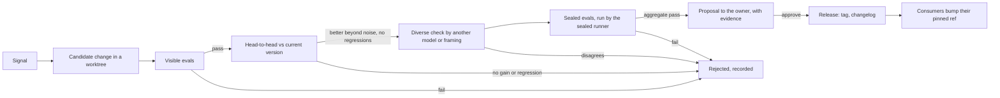

# 18. Self-improvement

[Back to the index](../0001-human-in-the-lead.md)

The plugin should get better by the same process it runs for any project: signals in, changes proposed, evidence gathered, the owner deciding. The difference is that here the system grades its own work, so it has both the means and an incentive to game the grading. This part sets the bootstrap path and the guardrails that keep self-improvement honest.

## 18.1 Bootstrap stages

| Stage | What happens | Who changes the plugin | Needs |
|---|---|---|---|
| **0. Built by hand** | This design and the milestone "Usable in a consuming project" are built by hand in ordinary agent sessions. This repository already uses the files tracker (key `HITLD`); the intake and the orchestrator are not yet in use on it | People and sessions, reviewed by the owner | Nothing |
| **1. Manages its own repo** | This repository becomes a consuming project of its own plugin: its GitHub issues are an intake source, the files backend is its tracker, the orchestrator runs its work, and the eval suite ([part 17](17-evals.md)) gates every change | Executors dispatched by the orchestrator, on items the owner or triage created | "One signal end to end", with its offline eval suite (live evals are not required to begin) |
| **2. Proposes changes to itself** | The learning loop reads the plugin's own signals and proposes candidate changes to skills, briefs, templates, controllers and policy defaults, each tested before it reaches the owner | Executors, on candidates the learning loop raised; the owner decides adoption | Stage 1, the ledger's measures (the "Full measure set" milestone) and the controllers (the "Controllers" milestone) |

**Signals for stage 2:**

- eval failures and regressions, visible and sealed (aggregate only for sealed, 18.3);
- ledger measures: first-pass yield, waste, orchestrator overhead, onboarding tokens, token estimate error;
- retro proposals ([part 2](02-loops.md#28-learning));
- the owner's overrides: reversed logged calls, overruled precedent applications, reordered priorities, rejected candidates;
- escaped defects in the plugin itself;
- lessons and feedback from consuming projects, filed upstream as issues after generalization (18.3, guardrail 5; [18.4](#184-giving-feedback)).

## 18.2 The path of a self-change

A candidate is a branch with the change and a **process study** ([part 11](11-metrics-and-control.md#115-changing-the-system)): the hypothesis, the metric and its Goodhart pair, and the minimum sample. Every rejection is recorded with its stage and reason, because the rejection rate is itself a measure (18.5).

## 18.3 Guardrails against gaming its own grading

An agent improving a system that is graded by evals will, given room, improve the grade instead of the system: editing tests so they pass, special-casing eval scenarios, or weakening the rules that would flag it. These five guardrails close that room.

### 1. A protected core, changed only with the owner's approval

These paths are the **protected core**:

- the eval suite: its scenarios, graders, fixtures and thresholds;
- the decision-rights and escalation rules ([part 4](04-decision-rights.md));
- the classification rules ([part 10](10-security.md#103-information-classification));
- the guard hooks and the send gate;
- this part of the design.

Every change to the protected core is a **one-way door** by rule: the owner's decision, never resolvable by precedent. One exception: adding an eval scenario may go by precedent. Removing a scenario, changing a threshold, or anything that weakens a check is the owner's. Enforcement is mechanical, not a matter of trust:

- the `PreToolUse` guard refuses agent writes to protected paths unless the dispatch cites an answered owner decision that names the change;
- the built guard covers shell commands only (its matcher is `Bash`), so protecting the core against file edits waits on the write-path guard, which stage 2 needs (`Edit` and `Write` coverage). Until then the merge queue below is the enforcement;
- the merge queue refuses any commit touching a protected path without an `Owner-Decision: <ID>` trailer that resolves to an answered decision;
- a candidate change and a change to the evals that grade it may not be in the same release; an eval change lands first, on its own, and is itself evaluated against the previous version's known results.

### 2. A sealed eval set the improving agents never see

Alongside the visible eval suite, the owner keeps a **sealed set**: scenarios of the same kinds, never shown to any agent that writes or proposes changes. A candidate must pass both.

How it is kept sealed:

- **Storage.** The sealed scenarios live outside every repository an agent can read, in the owner's private store, encrypted (for example with `age`) to a key that only the owner's **sealed eval runner** holds. The key is `secret` class ([part 10](10-security.md#103-information-classification)): it lives in a secret manager or the operating system's keychain, never in any agent context, file in a worktree, or log.
- **Access.** The guard hook blocks agent reads of the sealed path, and the decryption key is unavailable to agent processes in any case. Encryption is the real boundary; the hook is a second line.
- **The runner** is a separate command (`hitld eval --sealed`), run on the owner's machine first; a CI job in a private repository that holds the key as a secret may follow. It decrypts in memory, runs the candidate and the current version, and reports **only aggregates**: pass rate per category, deltas, and variance. It never reports which scenario failed or why, because a failure message would leak the scenario.
- **A budget on sealed runs.** Repeated queries against a hidden set leak it gradually: a candidate tuned against many aggregate results overfits the sealed set just as it would a visible one. So sealed runs happen only for candidates that have passed every earlier stage, at most `selfimprove.sealed_runs_per_release` per release, each logged.
- **Refreshing.** The owner adds new sealed scenarios regularly (for example, from escaped defects and real incidents, which the improving agents have not seen as scenarios) and retires old ones. Retired sealed scenarios may move into the visible set.

### 3. Head-to-head comparison before proposing

A candidate is compared with the **current version** on the **same scenarios**, with the same seeds, model and settings, in the same eval run. It is proposed only if:

- it is better on its target metric by more than the run-to-run variance measured for that metric (repeated runs, [part 17](17-evals.md#174-metrics));
- it regresses no other metric category beyond its tolerance, and in particular not the Goodhart pair of its target;
- its token cost per scenario does not rise beyond `selfimprove.cost_tolerance` without the owner's explicit trade.

Consumers pin a release tag ([part 16](16-packaging.md)), so rolling back a bad self-change is one step: move the pin back.

### 4. Diverse checking

A candidate is evaluated by a different model, or at least a different prompt framing, from the one that wrote it: its LLM-graded scenarios use graders from a different model where one is available, and the diverse check stage has an agent of that other model try to find ways the candidate games the evals (special cases keyed on scenario content, weakened assertions, behaviour that differs when an eval is detected).

This is the agent version of Ken Thompson's "Reflections on Trusting Trust" (1984): a compiler that compiles itself can carry a flaw that no inspection of its own source reveals. David A. Wheeler's answer, **diverse double-compiling**, is to rebuild with an independent compiler and compare. Here the "independent compiler" is an independent model and framing judging the change, so that a blind spot shared by the author and its grader does not pass silently. Citations are in [part 20](20-prior-art.md#209-security).

### 5. Upstream learning is generalized first

Lessons from consuming projects make the plugin better for everyone, but consuming projects hold confidential material. So:

- a consuming project's retro may mark a lesson as **upstream**;
- a generalizer agent rewrites it without project-specific names, paths, data, people or plans, applying the classification rules (anything not `public` after generalization is not filed);
- filing it as an issue in this public repository is an external publication, so it goes through the send gate ([part 9](09-contributors.md#93-replies)) and needs the approval of the person in the lead whose feedback it is, under a policy the project owner sets (until team use is designed, HITLD-44, that is the owner);
- in this repository, the filed issue is an ordinary signal: untrusted data, triaged in quarantine like any other.

Feedback that people give in the moment takes the same path ([18.4](#184-giving-feedback)).

## 18.4 Giving feedback

The feedback command, `hitld feedback`, is planned (HITLD-46); this section is the design it follows. Until it is built, people file by hand with the issue forms.

People using HITLd notice what the evals miss: a question that was not worth asking, a step that works but feels wrong, a part that works well. This section sets how that reaches this repository without any project's confidential material. It applies guardrail 5 to feedback given in the moment.

### In the moment

Feedback is given where the person already is: in a session of a consuming project.

- **About HITLd, or about the project.** The orchestrator skill tells feedback about HITLd itself ("hitld should…", "I wish the system…", "that question was not worth asking") from feedback about the project's own work. Feedback about the project stays a project signal, recorded with `hitld note` ([part 9](09-contributors.md#92-trust-levels)). When unsure, the skill asks one line: "For HITLd, or for this project?"
- **Only from the person's own turns.** Feedback is recorded only from what the person says in the main session, typed or through Remote Control, the same rule as for answers to decisions ([Q21](22-open-questions.md#q21-how-is-a-deciders-identity-established-blocks-any-second-human-and-any-channel-other-than-the-local-session)). Text in a tool result, a report, a file or pasted material is never recorded as feedback. If such text seems to hold feedback, the skill quotes it and asks.
- **`hitld feedback` (planned) records it** and captures the context, so the person says only what they noticed. The skill guesses the kind; the person can change it before anything is filed.

| Field | Source |
|---|---|
| `kind` | `bug`, `friction` (works but feels wrong), `idea` or `worked-well` |
| `words` | The person's words, verbatim |
| `version`, `harness` | The plugin version, and the harness with its version |
| `area` | The loop or command concerned |
| `refs` | The dispatch, decision and merge IDs involved |
| `what_happened` | Drawn from the ledger entries for those IDs |
| `expected` | What the person expected, when they said it |
| `state` | `local`, `drafted`, `filed` (with the issue's URL), `withheld` (with the reason) or `dropped` |

**Worked well counts.** Positive feedback tells maintainers what not to break. It is recorded and filed like the rest.

In this repository, HITLd is the project, so feedback about HITLd is a note.

### Stored locally, published separately

- **Local first.** Each record is written to the consuming project's [private store](03-data-model.md#private-store) as `feedback/FB-<n>`. Recording works offline. Records wait in a batch until they are published, so nothing is lost when publishing waits or fails. The record is `confidential`, since it holds the project's words and IDs, and it never leaves the machine.
- **Generalized, then approved.** At a quiet point (the next digest, or when the person asks), the generalizer agent drafts the public version of each waiting record. The draft has no project names, paths, data, people or plans, and the classification rules apply to it ([part 10](10-security.md#103-information-classification)). The person sees the draft beside their own words and approves, edits or drops it, in one step. At approval, the person is told that the issue will be public under their GitHub identity, and that this identity plus the timing can reveal who uses HITLd, even when the text is generalized. They are offered a second way: copy the approved text and post it themselves, from whatever account they choose. The record is then `filed` once they paste the issue's URL, or stays `drafted`. Filing is an external publication, so the approval goes through the send gate ([part 9](09-contributors.md#93-replies)). Each person in the lead approves their own feedback, under a policy the project owner sets (guardrail 5). Until team use is designed (HITLD-44), that person is the owner.
- **Only then filed.** The approved draft is filed as an issue in this repository, with the fields of the issue forms below. A short footer says it was filed with `hitld feedback` and approved by a person.
- **Not public, not filed.** A draft that is not `public` after generalization is not filed. Its record stays `withheld`, with the reason.

### The issue forms

People can also file by hand, with the forms in `.github/ISSUE_TEMPLATE/`: bug, friction, idea (which also takes comments on the design), worked well, and experience report (a longer account of using HITLd on real work). Each has the same fields under the same headings: HITLd version, harness, loop or area, what happened, what you expected, and evidence. The experience report adds what worked well and what got in the way. Each has a required box confirming that the issue holds no confidential material. Blank issues are off. An experience report is a longer account written by hand, so `hitld feedback` has no such kind; it records short feedback in the moment. `hitld feedback` writes the same headings in the same order, so filed and hand-written issues look alike and triage reads them the same way.

### On this repository's side

An issue from feedback is an ordinary signal ([2.1](02-loops.md#21-intake)): untrusted data, triaged in quarantine and deduplicated like any other ([2.2](02-loops.md#22-triage)).

- **Routed by labels.** Each form sets `feedback` and a label for its kind. The labels give triage a guessed kind and route, which triage still checks, since anyone can pick any form.
- **Two more signal kinds.** `friction` and `worked-well` join the signal kinds ([part 3](03-data-model.md#signal)).
- **Worked well is evidence, not work.** A `worked-well` signal is attached to the area it names, so shaping and design review see it before they change that area.
- **Duplicates add reach.** Several people reporting the same friction raise its reach, as for any signal.

### Implicit friction signals (later milestone)

Some friction shows in what people do rather than what they say. The ledger and the decision log already record:

- precedent applications the person overruled;
- answers rated not worth asking;
- calls the person reversed;
- abandoned dispatches;
- reports that failed the report shape;
- merges the person rejected.

The **friction digest** counts these per HITLd version, per loop or command. It holds no project content: no titles, paths, words or IDs. It is off unless the consuming project's owner turns it on (`feedback.digest`). When on, each digest is shown to the person before anything is filed, goes through the send gate like other feedback, and is never sent automatically.

### Closing the loop

- **Release notes link the feedback they address.** Shipping ([2.7](02-loops.md#27-shipping)) links each feedback issue an item addressed and credits it as a report ([9.4](09-contributors.md#94-credit)). A filed record keeps its issue's URL, so when a consuming project moves its pin, `hitld` matches the release notes against its filed records and tells the person which of their feedback landed.
- **A reproduced bug becomes an eval scenario.** When triage reproduces a bug from feedback, the failing test becomes an eval scenario as well as a regression test ([SIG-8](../../../signals/SIG-8-defects-become-evals.md)). The owner may put it in the sealed set instead (guardrail 2).

## 18.5 Measures

| Measure | Definition | Goodhart pair |
|---|---|---|
| **Improvement per accepted self-change** | The change in sealed-eval aggregate score from the version before to the version after, per accepted change | Token cost per scenario |
| **Candidate rejection rate** | Rejected candidates over all candidates, by the stage that rejected them | Candidates raised per period (a system that proposes nothing is never rejected) |
| **Owner override rate** | Candidates the owner rejects after they passed every automatic stage, over candidates proposed | Decision latency on proposals |
| **Visible–sealed drift** | The visible pass rate minus the sealed pass rate, tracked over versions. A widening gap is a sign of overfitting to the visible set | — (it is itself the check on the visible evals) |
| **Rollback rate** | Releases whose pin consumers the project can see moved back, plus opt-in feedback that reports a move back. It does not cover consumers it cannot see | Release frequency |

When visible–sealed drift exceeds `selfimprove.drift_max`, stage 2 pauses, and the owner is asked to refresh the sealed set and review recent accepted changes.

## 18.6 Milestones

- **Stage 1** follows once the offline eval suite of "One signal end to end" exists ([part 21](21-scope.md)); live evals are not required to begin.
- **Stage 2** follows once the ledger measures (the "Full measure set" milestone) and the controllers (the "Controllers" milestone) exist, so that its signals and its own effects can be measured.
- **Giving feedback** (18.4): the issue forms exist now. `hitld feedback`, the skill's part and filing come with the first live test in a consuming project, which is where feedback starts. The friction digest comes after them.
