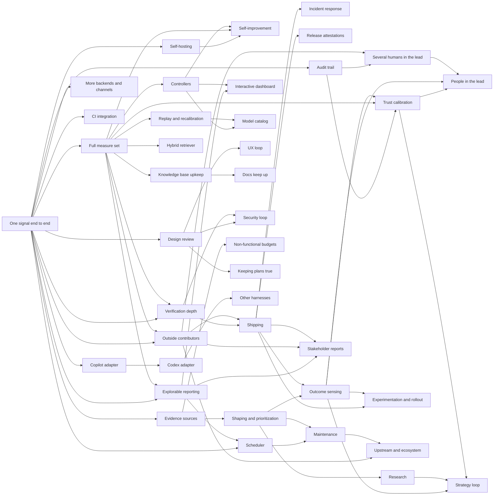

# 21. Scope and milestones

[Back to the index](../0001-human-in-the-lead.md)

Milestones are defined by what they deliver and what they depend on. There are no durations. Milestones are never numbered: each is named by its outcome, and order comes from what each needs ([part 3](03-data-model.md#milestones-and-releases)). Once milestone entities are built, each milestone here can be tracked as one, with its "done when" and its independent check.

The milestone and the version line are different things. Version numbers (v0.y.z, then 1.0) name releases, and a release can be cut at any green merge. "One signal end to end" names a future state; several releases may ship before it is reached.

## 21.1 One signal end to end: the smallest slice worth using

This milestone is reached when one signal can travel the whole path (arrive, be triaged, become an item, be executed in parallel with others, be adversarially tested, merge and close) with the owner involved only for calls that are theirs, with every step recorded, and with an eval suite that will catch the next change that breaks any of it.

This is bootstrap **stage 0** ([part 18](18-self-improvement.md#181-bootstrap-stages)): the milestone is built by hand, through ordinary sessions the owner directs.

### What it contains

| Piece | In it | Not in it |
|---|---|---|
| **Neutral core** | Schemas with `schema_version`; the `hitld` command line and Node library holding all logic; a thin MCP server generated from the same command table (tools only; not yet built); a fake harness adapter for core tests. No core code calls a harness directly | — |
| **Portable instructions** | The executor contract block for `AGENTS.md` and `hitld check contract`; skills in `SKILL.md` format with portable front matter, calling `hitld` | Playbook packaging for harnesses without skills |
| **Claude Code adapter and packaging** | Tier 1–2 dispatch as background subagents with worktree isolation; tier 3 as headless runs in a worktree, or interactive sessions; completion, follow-ups, Remote Control for questions; plugin-level hooks; the plugin and this repository's marketplace; release tags; consumer setup through a package script (planned, HITLD-25) | Other harnesses |
| **Orchestrator skill** | Run start; ready queue; sizing into tiers 0–3 with policy defaults; dispatch up to a fixed cap with serial resources; refill on completion; follow-ups to the same agent; the local merge queue with batch testing, bisection and view regeneration; restart from files with a generated hand-over note | Controllers (cap and tiers stay at policy values); speculative execution |
| **Orchestrator continuity** | The run-state file; checkpoints at clean points with the ledger written first; the one-orchestrator lease; `hitld run resume` and `rebuild`, on either machine | — |
| **Environment resource manager** | Worktree creation, declared per-worktree setup and cleanup, with cleanup that never follows a link out of the worktree (planned, [13.2](13-operations.md#worktrees)); dev-server port leases that never touch servers the manager did not start; locks on serial resources; secrets injected into child processes only, scoped by role, filtered from output; the per-harness differences for Claude Code | Copilot and Codex setup generation |
| **Settings in four layers** ([part 13](13-operations.md#134-settings-in-four-layers)) | Before the first release: the person and machine files with schemas and trusted loading; strictest-layer precedence; `hitld config explain`; `hitld machine detect`; the first-run walk-through in the orchestrator skill; the machine-wide registry of live executors and per-account usage, with the merge queue lock per repository; machine roles. After it: load-aware admission, quiet-machine holds and resource capacities | Syncing the person file between machines |
| **Basic merge queue** | Owner merge mode (`merge.mode: owner`) as the default for new projects, with the checks run before the owner is asked, one approval per batch, approvals recorded as trust events and owner mode limited by path or area (built); dependency order; rebase and fast checks; the full suite once per batch; bisection; generated-file conflicts regenerated; semantic conflicts back to the executor; a full-suite failure that passes on rerun is recorded as a flake candidate and holds the batch for the owner (the base comparison, burn-in and the quarantine file of [14.7](14-integration.md#147-flaky-tests) come later); views regenerated on `main` ([part 14](14-integration.md)) | The agent conflict resolver; CI integration |
| **Tracker interface and files backend** | The `TrackerAdapter` interface; the files backend in the reference format, generalized (configurable key and paths); schemas with unknown-key rejection; claims read from branches; close on merge; ID allocation (orchestrator only, reserved blocks); `hitld work check`, `views`, `claims`. The versioned JSON read API with declared fields, `hitld work migrate` and a backend conformance suite. Before the first release: milestones and releases as entities, with release records, `hitld release propose` and `hitld release make` (HITLD-45, [part 3](03-data-model.md#milestones-and-releases)) | Hosted backends |
| **Ledger** | Append-only ledger in the private store with every field in [part 5](05-execution.md#54-the-ledger), including brief hashes and skill versions; `hitld ledger in-flight` and `summary` (tokens per accepted item, first-pass yield, waste, decision latency) | The full measure set; dashboard |
| **Decision rights with precedent** | Rights rules in `policy.json` and `hitld rights`; decision items; the stand-alone question format with the precedent offer; precedent creation with the decider's confirmation, matching, application listed in digests, overrules | Strength reviews and freshness flags beyond a manual check |
| **Intake and triage** | Two sources: GitHub Issues for a named repository (pull, not webhooks) and the owner's notes (`hitld note`); normalization into signals; the quarantined triager with schema-validated output; deduplication, classification and routing; the sandboxed reproducer turning bugs into failing tests; auto-fix only under a confirmed precedent, and only for known reporters (T1 and above, [Q4](22-open-questions.md#q4-may-a-reproduced-bug-from-an-unknown-reporter-become-planned-work-without-a-human)) | Reply sending (drafts are shown to the owner); more sources; the hybrid retriever |
| **Verification** | A minimal acceptance author that writes checks from the item's spec before or alongside the executor, without seeing the implementation; items are dispatched only when their "done when" is an executable check that exists before the executor starts (a reproduced test, or one the acceptance author wrote) | Property, metamorphic and differential templates; mutation testing; the `Brief`, `Plugin-Version` and `Evidence` trailers (this milestone carries `Work-Item`, `Dispatch`, `Agent-Role`, `Agent-Model` and `Agent-Effort`); reliability metrics |
| **Adversarial-testing loop** | An invariant registry for one area; the adversary agent; every break committed as a failing regression test with a fix item; adversarial passes on every change in that area | Allocation by yield |
| **Eval suite** | The suite in [part 17](17-evals.md#178-the-suite-for-one-signal-end-to-end): scenario format, fixtures, graders, `hitld eval --offline` and `--live`, the Claude Code runner via `claude plugin eval` for skill scenarios and the end-to-end runner (neither yet built), results with version and model recorded, the regression gate, and the Copilot cloud agent profile against the fake adapter | Controller and replay scenarios (with Controllers, and with Replay and recalibration); other harnesses' runs |
| **Security baseline** (required by intake, which reads untrusted text) | Least-privilege agent definitions; the `PreToolUse` guard (built for Bash only: no push, no moving main, the `hitld` allowlist for executors, no decision commands, no eval accept; write paths, dependency gate, secret paths and network allowlist still to come); the commit guard (the classification check is built, HITLD-51: the pre-commit hook `hitld install` writes, the same rule at merge in either mode, and `hitld work check` over the whole tree; the secret scan is still to come); security in "done when": diff-aware scanning against a baseline, triage verdicts and accepted risk with expiry (planned, HITLD-63, before the first release), with an independent security review for sensitive paths and threat-model notes (HITLD-34) ([10.5](10-security.md#105-security-in-done-when)); the quarantine pattern; the reproducer's sandbox | OS sandboxing of external PR tests (no external PRs are tested automatically in this milestone) |
| **Trust-calibration data** | Reversals of system decisions, one-tap "worth asking?" ratings on answers, and precedent overrules recorded per area from the first run; judgements recorded on signals (`what`, `basis`, `by` in public); the judgement record's `confidence`, `expected` and `evidence_at_time`, in the private store ([Q22](22-open-questions.md#q22-do-the-new-judgement-record-fields-join-one-signal-end-to-end-affects-its-record-scoring-waits-for-people-in-the-lead)) | Autonomy proposals (Trust calibration); outcome matching and scores (People in the lead) |
| **Reporting and limits (minimal)** | Ledger usage; quotas declared in `policy.json` with the owner's reserve; opt-in status-line snapshots of the window percentages where available; the opt-in status-line readout ([12.1.1](12-reporting-and-limits.md#1211-the-status-line-planned)); a forecast per quota; the reserve rule enforced at dispatch; `hitld dashboard` writing a static HTML report and a text digest ([part 12](12-reporting-and-limits.md#127-the-minimal-version)) | Explorable dashboards; controller replay; vendor API readers; per-audience reports |
| **Notification** | Remote Control through the main session: interrupts for critical-path and idle-slot questions; digests when `hitld cadence due` says one is due (thresholds, the owner writing, an idle machine); quiet hours as holds | Other channels |
| **Private store** | A directory outside the repository: git text files for what syncs, SQLite for machine-local state and a rebuildable index ([part 3](03-data-model.md#private-store)); `hitld store export`, `import` and `sync` | Other backends |
| **Knowledge base** | The structure, front matter, the generated index and the `kb` tool's `search`, `index`, `stale`, `links` and `check` (not yet built) | Gardening loop, contradiction pass, hybrid retriever |

### Usable in a consuming project

This milestone is narrower than "One signal end to end": the point at which a consuming project can start using the system. It is the subset that orchestration needs, and it is built. The rest (the commit guard, intake and triage, the reproducer, the acceptance author, the adversarial loop, the full eval suite, the rest of the security baseline, notification digests) needs it.

- The neutral core: schemas, the `hitld` command line and library, `policy.json` loading, the fake adapter.
- The files tracker backend in the reference format, generalized (check 7 below is this milestone's acceptance for it).
- The ledger, and orchestrator continuity (run state, checkpoints, `hitld run resume`).
- The environment resource manager (worktrees, port leases, locks, secrets).
- The executor contract block and `hitld check contract`.
- The orchestrator skill with the Claude Code adapter: sizing, dispatch, the report shape, the basic local merge queue, the question protocol.
- Decision rights with precedent (rules, decision items, the question format, confirmed precedent, matching).
- The quota reserve rule at dispatch, with declared limits.
- Packaging: the plugin and the marketplace, installable from a local checkout.
- Offline evals for each piece above, so the next change is gated.

### Done when

All of these run on **synthetic fixture repositories** from the eval suite, not on a consuming project, except check 7.

1. **End to end.** A GitHub issue in a fixture repository becomes a signal; is triaged (linked to an existing duplicate where one exists, classified, reproduced into a failing test); becomes a `proposed` item that the owner commits with one tap; is dispatched to a tier-1 or tier-2 executor in its own worktree alongside at least two other items whose checks the acceptance author wrote; passes the adversarial pass for its area; merges through the queue; and closes in the merge. The ledger shows every event with tokens, and `hitld ledger summary` reports the run.
2. **A question routes correctly.** During that run, an executor meets a call that is the owner's by a rights rule; it becomes a decision item, other work continues, the owner answers through the main session, and the answer becomes a confirmed precedent. A second, matching question in a later dispatch is resolved by that precedent without asking, and appears in the digest.
3. **Restart.** The orchestrator session is killed mid-run; a fresh session resumes from the run-state file with no lost or duplicated dispatch, including when the kill falls between a ledger append and a checkpoint (the kill-and-resume eval).
4. **Injection is contained.** Every injection scenario in the suite passes: no agent acts on instructions in signals, the triager's output passes schema validation, and attempts are flagged.
5. **Leaks are blocked.** A commit adding a `confidential` file to a public repository is refused by the commit guard. *Built (HITLD-51): the offline scenario `security/commit-guard-refuses-confidential` shows the hook refusing the commit, the merge refusing the same file committed with `--no-verify` in owner and queue mode, and `hitld work check` naming it.*
6. **The eval suite gates.** `hitld eval --offline` passes in CI; `hitld eval --live` has a recorded baseline for the first release tag on Claude Code with its model and settings; a deliberately degraded skill fails the regression gate; the Copilot cloud agent profile passes against the fake adapter.
7. **Existing tracker, read-only.** `hitld work check` and `hitld work views` run against an existing in-repo tracker in the reference format with its key and paths configured, and agree with that tracker's own scripts' output.
8. **Environment.** Three executors run at once with dev servers: each gets its own worktree with setup run and its own port; a server the owner started on a port in the range is left untouched; the GPU lock serializes the two items that need it; a secret given to a script never appears in any report or log.
9. **The reserve holds.** With a declared quota close to its reserve, the orchestrator economizes, then stops autonomous dispatch at the reserve, tells the owner, and `hitld dashboard` shows the forecast that triggered it.
10. **Installable.** A fresh clone of a fixture consumer with the committed project settings installs the plugin pinned to the first release tag, and `hitld check contract` passes.
11. **Settings hold across projects.** With no person or machine file, the orchestrator walks the person through setup and dispatches nothing autonomously until it is done. Two fixture projects on one machine together stay within the person's cap, see the same account usage, and merge without waiting on each other's queue. A project cap looser than the person's has no effect, and `hitld config explain` shows the layer each value came from.

## 21.2 Later milestones

Each milestone names what it needs. Anything whose dependencies are met can proceed in parallel. Milestones carry no codes or numbers: each is named by its outcome, and order comes only from the Needs column. A milestone that already has a tracker entry shows its ID. When milestones become entities (HITLD-45), each gets its own ID, and prose refers to it by name.

| Milestone | Delivers | Needs |
|---|---|---|
| **Self-hosting** | Bootstrap stage 1: this repository manages itself with its own plugin: its GitHub issues as an intake source, its files backend as its tracker, the orchestrator running its work, the eval suite gating every change | One signal end to end, including its eval suite |
| **Copilot adapter** | VS Code agent mode for tiers 0–2 (custom agents per role, skills, MCP or command line, subagents, preview hooks treated as a subset); the cloud agent for tier 3 and intake to PR (dispatch by issue or GitHub CLI's `gh agent-task`, in public preview, report by PR comment, follow-up by `@copilot`, MCP configuration, classification limit); agent plugin packaging; the eval suite run against both | One signal end to end (core, MCP server, Copilot profile) |
| **Explorable reporting** | Explorable metrics as time series with filters; controller step log readout and what-if replay; token use against what it bought; progress reports with charts, sent on the triggers of 12.2; vendor usage readers (Anthropic APIs, OpenTelemetry, GitHub's billing usage API for Copilot) | One signal end to end (reporting); Full measure set |
| **CI integration** | The tier-1 conflict resolver for trivial conflicts; pushed candidate branches tested in GitHub Actions; special runners (GPU, benchmarks); GitHub's merge queue as a backend | One signal end to end (merge queue); an owner decision on pushing |
| **Scheduler** | Recurring jobs triggered by evidence, not the calendar, with the triggers declared in `policy.json`: intake and triage, digests, baselines, sweeps (stale items, stale knowledge, flaky tests), quota checks, maintenance scans, eval runs; `hitld cadence due` says what is due, and the chief of staff or a local or hosted scheduler runs it | One signal end to end (environment manager); Explorable reporting for digests |
| **Audit trail** | The hash-chained audit record of every decision with evidence and rule versions, linked to provenance | One signal end to end (decisions and ledger) |
| **Model catalog** | `models.json` with costs, capabilities and per-model calibration; a new model enters as trial and triggers recalibration | One signal end to end (sizing); Controllers for calibration; Replay and recalibration for replay |
| **Design review** | The design template, judgement-call extraction, the gate from design to items, answers as precedent | One signal end to end (decisions and precedent) |
| **UX loop** | Automated UX checks (accessibility, themes and widths, keyboard, console, design-system conformance, visual regression, API consistency and idiom rules); heuristic review; phone-friendly review packs; UX evals | One signal end to end; Design review for design-guide precedent |
| **Outcome sensing** | Outcome measures at shaping; outcome checks after shipping; adoption, downstream usage, feature issues, benchmark trends; UX usage evidence; calibration of value estimates | Shaping and prioritization; Shipping |
| **Maintenance** | Dependency and toolchain updates, advisories, the technical-debt register, internal deprecations, at the portfolio's maintenance share | Scheduler; Shaping and prioritization for the portfolio share |
| **Docs keep up** | Documentation in "done when" for user-visible change, runnable examples, docs freshness through the `kb` tool | Knowledge base upkeep |
| **Several humans in the lead** (HITLD-53) | Delegation by area, disagreement handling, per-human attention budgets, onboarding for new co-maintainers; signed decision answers (HITLD-36); how a team shares the loops (HITLD-44) | Audit trail; Outside contributors |
| **Stakeholder reports** | Per-audience reports and release notes with classification ceilings, through the send gate | Explorable reporting; Outside contributors; Shipping |
| **Trust calibration** | Overturn, worth and precedent-accuracy measures per area; autonomy proposals as owner decisions; calibration of owner-judgement weights against outcomes | One signal end to end (trust data); Audit trail; Full measure set; Outcome sensing for judgement calibration |
| **People in the lead** | Outcome matching; per-person, per-area prior weights that tune themselves by shrinkage; the private calibration review with the decision journal and Brier scores; adapting each person's interface defaults (the person file itself comes before the first release); the onboarding practice set; question-quality evals ([part 23](23-people-in-the-lead.md)) | Trust calibration; Outcome sensing for outcomes; Several humans in the lead for area owners |
| **Strategy loop** | Evidence-triggered strategy reviews; setpoints for prioritization and controllers | Outcome sensing; Research; Trust calibration |
| **Security loop** | Threat modelling in design review; scanning beyond the diff-aware merge checks of the first release (scheduled full scans, more tools, the baseline worked down); private vulnerability intake and responsible disclosure; red-team evals as standing release gates | One signal end to end (security baseline and injection evals); Design review; Verification depth for fuzzing |
| **Non-functional budgets** | Budgets in `policy.json`; regressions and trends turned into items from benchmark, build and billing measurements | Evidence sources; One signal end to end (merge queue) |
| **Keeping plans true** | Design-changing deviations update the design or file plan drift; the merge-queue check; the periodic drift pass | Design review |
| **Experimentation and rollout** | Feature flags with removal items; dogfooding; staged rollout with measurement gates; automatic rollback on a failed gate | Shipping; Outcome sensing |
| **Upstream and ecosystem** | External items for dependency bugs with re-test follow-up; fixes contributed back through the send gate; standards work tracked | Outside contributors; Maintenance |
| **Full measure set** | The full measure set in [part 11](11-metrics-and-control.md#111-measures) from the ledger and git; onboarding tokens from transcripts; Goodhart pairs in every report | One signal end to end (ledger) |
| **Controllers** | Sizing, concurrency, review allocation, question timing and run token budget controllers; policy bounds; stability rules; oscillation detection; their simulated-ledger eval scenarios | Full measure set, and enough ledger samples |
| **Self-improvement** | Bootstrap stage 2: the plugin proposes changes to itself from its signals; the protected core enforced by guard and merge queue; the sealed eval set, its encrypted store and owner-held runner; head-to-head comparison; diverse checking; upstream lessons generalized; the self-improvement measures | Self-hosting; Full measure set; Controllers |
| **Verification depth** | Property, metamorphic, differential and fuzz templates; mutation testing on the diff; the `Brief`, `Plugin-Version` and `Evidence` trailers; reliability growth per area; human-read triggers and directed reads | One signal end to end (adversarial loop and acceptance author); Full measure set for reliability |
| **Knowledge base upkeep** | The gardening loop; the contradiction pass; `kb_miss` tracking; orphans; brief pointers by area and paths | One signal end to end (knowledge base; ledger citations); Full measure set (onboarding tokens) |
| **Hybrid retriever** | The optional keyword-plus-embeddings index as a rebuildable cache, for intake deduplication first and the knowledge base if measured | One signal end to end (triage); Full measure set; a trigger in [part 8](08-knowledge-base.md#retrieval) firing |
| **Evidence sources** | The evidence-source adapter; studies and runs summarized from the project's benchmark tool; process studies in the private store | One signal end to end |
| **Shaping and prioritization** | Projects being shaped; appetite in tokens; cost-of-delay profiles; the ordering rule with value of information and portfolio balance; the strategy page; the betting decision | One signal end to end (intake and triage); Evidence sources |
| **Outside contributors** | Trust levels; the liaison agent; the send gate with routine and sensitive classes; credit; community health measures; DCO check in the merge queue; sandboxed testing of external PRs | One signal end to end (triage and security baseline); Full measure set |
| **Shipping** | Release assembly from item files, on the release records and `hitld release propose` built before the first release; changelog with credit; deprecation notes; docs in "done when" for public surface; the release controller in the shipping loop | Verification depth for provenance; Outside contributors for credit |
| **Incident response** | Severity; the sev-1 page through quiet hours; rollback first; hotfix flow; blameless reviews whose outputs are rule-change decisions | One signal end to end (triage); Shipping |
| **Replay and recalibration** | The replay corpus and harness as eval scenarios; live interleaving; recalibration on model changes | Full measure set; ledger history with brief hashes (recorded from the start) |
| **Interactive dashboard** | Interactive readout, fleet view and safe intents applied by the main session, on the reporting data contract | Explorable reporting; Controllers |
| **More backends and channels** | Tracker backends for GitHub Issues, Linear and Jira; Slack and push channels; webhook intake; digests and reports pushed to those channels | One signal end to end, its interfaces unchanged through at least one consumer's use |
| **Codex adapter** | Headless and cloud dispatch, its skills and plugin packaging, the eval suite run against it | Copilot adapter (the second adapter proves the interface; the third should need no core change) |
| **Other harnesses** | Cursor; Google's current CLI harness (Gemini CLI or its successor) | Codex adapter |
| **Research** | Desk research agents; research briefs for the owner; the confidential research store and declassification decisions | Shaping and prioritization |
| **Release attestations** | SLSA provenance for releases. Partly built: the release workflow already attests build provenance | Shipping |

Adopting an existing tracker ([part 16](16-packaging.md#167-adopting-an-existing-in-repo-tracker)) runs alongside: step 1 needs only "One signal end to end"; the adversarial loop on a real area follows its check 7 and the owner's choice of area ([part 22](22-open-questions.md)).

## 21.3 After this design

"Usable in a consuming project" is built. The rest of "One signal end to end" is planned in this repository's own tracker: the project ready for consuming projects and the first release (HITLD-15), and the rest of the slice (HITLD-28). Later milestones get their own design documents (`0002-…` onward) when they come up, each citing this one.
